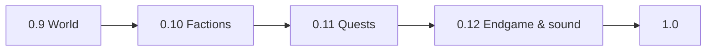

# AssemblyCraft — Roadmap to V1: 0.9 World → 0.10 Factions → 0.11 Quests → 0.12 Endgame & sound → 1.0

## Context

AssemblyCraft (x86-64 NASM, `master` HEAD `626bc8b`, 0.8 "Builds", 129 selftests, ~64k lines) is a fixed 256×64×256 world with one village, 6 dungeons, a crypt boss, one elder quest chain of 8, 4 classes with 18-node trees, rolled gear, elements and statuses. The goal is a proper V1 with a much bigger, procedurally richer world; NPC variety; new quests; neutral and hostile factions with reputation that opens quests when standing is high enough.

Decisions taken with the user:
- infinite chunk-streamed world, 256 blocks high;
- 0.6–0.8 saves are dropped (no converter);
- a small hand-designed faction set (4–5);
- reputation via faction rivalries + shrine tribute + a quest chain once neutral (no decay);
- quest templates plus one short written arc per faction;
- 6 biomes with rivers, layered caves, oceans and islands;
- NPC fighters with classes, camp roles, wandering NPCs, named champions, a companion;
- V1 polish = music/ambience, an endgame goal, difficulty/accessibility, a performance/robustness pass (no tutorial).

Engine first: the world engine ships alone in 0.9, content lands on top. Each milestone gets its own design spec → plan → parallel-worker execution, as 0.8 did (`2026-11-08-assemblycraft-builds-design.md` is the model).

## Principles

- Every milestone ends playable: `make test` green, warning-free build, the live checks of its spec passed in omabox, one commit per wave, a design doc with an "As built" section.
- Content is data-driven where it varies per faction/biome (tables in one owning `.asm` file), so later milestones add rows, not conditionals.
- No old-save compatibility from 0.9 on: the world list shows pre-0.9 files as "incompatible (0.8)" and refuses to open them; the file is never modified.
- Game text stays in English. Conventions of 0.8 (SysV, header comments, `test_<name>` selftests with negative controls, omabox live checks) carry over.

## Milestones

|Version|Theme|Playable result|Relative size (0.8 = 1)|
|---|---|---|---|
|0.9 World|Infinite chunk-streamed world, 256 high; 6 biomes, rivers, two cave layers and ravines, oceans and islands with water physics and a boat; region-based site planner with reserved faction-camp slots|Explore without limit in a varied world; everything from 0.8 still works|1.5|
|0.10 Factions|5 hand-designed factions with camps in their home biomes; reputation (rivalries, shrine tribute, standing tiers); camp roles (leader, trader, guard, worker, captive); faction fighters as enemies; patrols and travelling traders; named champions|A world that reacts to the player|1.5|
|0.11 Quests|Quest templates with rolled targets and scaled rewards; a written 4–5 step arc per faction; journal screen; companion/hireling from allied factions|Something to do everywhere, a payoff per faction|1.0|
|0.12 Endgame & sound|Final objective (unite or crush the factions → far structure → final boss → credits); procedural music per biome/time; ambient sounds; difficulty tiers|A game that can be finished|0.7|
|1.0|Colourblind-safe elements and remappable mouse buttons; 60 FPS floor on a modest GPU and hitch-free streaming at 16 chunks; save robustness and long-session memory audit; bug sweep|Ship|0.7|

Dependencies: 0.10 needs 0.9's region site planner and biome ids; 0.11 needs 0.10's camps, roles and reputation; 0.12 needs 0.11's arcs (the endgame is gated on faction standings); 1.0 needs everything.

## 0.9 World — brief for its spec

Fixed decisions (so later milestones don't rework them):
- **Chunks:** 16×16×16 cubic chunks, world height 256 (y 0..255, 16 chunks per column), horizontal coordinates signed 32-bit. The flat `blocks` array and the `(y<<16)|(z<<8)|x` index (70 shift sites across `world.asm`, `light.asm`, `containers.asm`, `placement.asm`, `shapes.asm`, `fire.asm` and their tests) are replaced by a chunk table keyed by chunk coordinates; `world_get/world_set/world_is_solid/world_is_opaque/world_top_y` keep their signatures with 32-bit x/z and return AIR / "solid" outside loaded chunks as today's out-of-bounds does.
- **Loaded set:** a square of columns around the player, radius = render distance (2..16 chunks, settings `render_dist`), generated on demand on a worker thread (the first thread in the codebase: generation + light only; meshing and GL stay on the main thread). Chunks outside radius+2 unload after saving.
- **Save layout:** one directory per world (`acv3/worlds/NAME/`): `world.hdr` (magic "ACRAFT06", header = today's 32768-byte header minus `.containers`, plus the biome/temperature seeds) and region files `r.X.Z.bin` of 32×32 columns, each column stored as a sequence of its non-empty 16³ chunks (4096 bytes blocks + 4096 bytes packed light) plus the containers inside the column (today's `CONTAINER` records move from the header into the column). Mobs: as today in the header, positions in world coordinates. `MAX_MOBS` 32 → 64; `MAX_CONTAINERS` becomes per-column (≤ 32).
- **Terrain:** temperature and moisture noise pick one of plains, forest, desert, snow, swamp, mountains; a continent noise gives oceans (sea level y = 96) and islands; rivers follow the zero contour of a ridged noise and carve to sea level; caves are two layers (y 20..60 wormy tunnels, y 60..90 cheese caverns) plus ravines; ores by depth (coal shallow, iron mid, gold/diamond deep). New blocks: WATER (non-solid, source only, no flow), ICE, SNOW layer, SNOW_BLOCK, MUD, TALL_GRASS, CACTUS, PINE_LOG/LEAVES, BIRCH_LOG/LEAVES; SANDSTONE already exists.
- **Water:** swimming (reduced gravity, up on jump, slower move), breath meter (10 s) with drowning `env(1)` per second after, fall damage cancelled on water entry, mobs avoid water except drift; a craftable BOAT item (5 planks) placed on water as a ridden entity with its own simple physics; no flow, no buckets.
- **Sites:** `structures_plan` becomes per region: every region rolls from the seed 1 village or 0 (biome-weighted), 1–2 dungeons, a crypt every 4 regions, and reserves 5 faction-camp slots per 3×3 regions (one per faction, in its home biome) that 0.9 leaves as flagged clearings. F3 "Sites" lists the nearest of each kind.
- **Spawn:** the player spawns on the nearest land column to (0,0) with a surface biome that is not ocean/mountain.
- **Light:** sky and block light computed per chunk on the worker, propagated across loaded neighbours; the 0.7 light rules are unchanged.
- **Keep working:** all 0.8 systems, the recipe book, structures (villages, dungeons, crypt), saves of mobs/inventory/rpg, the merchant/elder.

Success criteria: walk 2,000 blocks in one direction at 16-chunk render distance with no frame over 50 ms; cross a river and an ocean by boat; find every biome in a seed-42 world; dungeon and crypt still spawn and clear; save, quit to title, reload at the far position with everything persisted; `make test` green with chunk/region/water/biome tests.

## 0.10 Factions — brief

- **Roster (fixed):** Villagers (friendly, plains/forest; today's village), Bandits (hostile, can be befriended; forest/mountains camps), the Ashen Cult (hostile; swamp; element magic), Beastfolk (neutral; snow/mountains; berserkers), Stonekin dwarves (neutral traders; mountains/caves). Rivalries: Villagers↔Bandits, Bandits↔Stonekin, Cult↔Beastfolk, Cult↔Villagers; the Cult is hostile to all and can only reach neutral, never allied.
- **Reputation:** per-faction signed 16-bit standing saved in the header; tiers hated < −200 ≤ hostile < 0 ≤ neutral < 200 ≤ friendly < 500 ≤ allied. Killing a faction member −10 (−50 for a leader/champion), killing its rival's member +5, shrine tribute +1 per 5 coins or per wanted item (each camp has a shrine block with its own use screen). Guards attack below 0, ignore at neutral, greet at friendly; the trader opens at friendly, the leader's quests at neutral, unique rewards at allied.
- **Camps:** one structure set per faction in its reserved slot (0.9), with the role NPCs (leader, trader, 2–4 guards, workers, 0–1 captive) as new mob types using the humanoid model with faction skins; fighters are humanoid enemies with a class (archer, brute, acolyte, berserker) using the player's weapon/element rules and dropping their weapon; patrols of 3 walk between camps on generated roads, traders wander with a stock.
- **Champions:** one named elite per faction with a unique tint/crown, level = player + 5, guaranteed legendary drop; sleeps in its camp until the arc (0.11) or a hated standing wakes it.

## 0.11 Quests — brief

- **Templates:** kill N (type/faction/level), bring N (item), clear a site, hunt a named elite, deliver to another camp, rescue a captive; targets rolled from the region around the giver; rewards = coins and XP scaled by level plus a `LOOT_SHOP` roll at friendly. Up to 3 active quests, journal screen (J) listing quests and standings; the elder's 0.6 chain becomes the Villagers' arc.
- **Arcs:** 4–5 written steps per faction ending in its unique reward (Bandits: a legendary dagger; Cult: a legendary staff; Beastfolk: a legendary hammer; Stonekin: a legendary chestplate; Villagers: the existing boss chain). Arc steps are templates with fixed text and fixed targets.
- **Companion:** at allied standing the leader offers one follower (a fighter of that faction) that follows, fights, has an equipment screen (weapon + armor) and respawns at the camp after 5 minutes if killed.

## 0.12 Endgame & sound — brief

- **Objective:** reach allied with 3 factions (unite) or kill 3 champions (crush) → the far Obsidian Spire appears on the map (≥ 1,500 blocks out) → final boss using the 0.8 pipeline with phases → credits screen; the world continues after.
- **Music:** generative per biome/time (scale, tempo, instrument set per biome; night variant), built on the existing synth (`sfx.asm` layers → a new `music.asm` streaming into the same PipeWire output); ambient loops: wind (mountains/plains), drips (caves), waves (ocean), insects (swamp night).
- **Difficulty:** Peaceful/Easy/Normal/Hard scale mob level offset (−2/−1/0/+2) and loot rarity weights, chosen at world creation, locked after.

## 1.0 — brief

- Colourblind-safe element palette option (shapes on damage numbers + alternate colours), mouse-button remap in Controls.
- Performance: 60 FPS floor on an integrated GPU at 8 chunks, no frame > 50 ms during streaming at 16 chunks; memory stable over a 2-hour session.
- Robustness: fuzzed region/header loads never crash; atomic region writes; a 4-reviewer sweep and a full seed-42 playthrough by the user.

## Critical files & anchors

- `src/common.inc`: `WORLD_*`, `CHUNK*`, `WORLDHDR`, `MOBSAVE`, `CONTAINER`, `SITE`: every layout the 0.9 spec replaces.
- `src/world.asm`: `world_get`/`world_set`/`world_load`/`world_save`: the chunk table replaces the flat array here first.
- `src/structures.asm`: `structures_plan`: becomes per-region in 0.9 and gains faction slots.
- `src/quests.asm`: `quest_tab` / `trade_tab`: the data the 0.11 templates generalise.

## Assumptions & contingencies

- Faction names, rivalries, standing thresholds, sea level 96, chunk size 16³ and the "ACRAFT06" directory save layout are defaults the user can change before the 0.9/0.10 specs are written; the per-milestone brainstorm re-confirms them.
- If the 0.9 spec finds the worker thread too costly in NASM (unverified whether the binary links pthread today — confirm first), fall back to time-sliced generation on the main thread (one chunk per frame, 4 ms budget) and keep the rest of the design.
- Relative sizes are estimates; if 0.9 overruns, oceans/boat move to 0.10 and the faction count drops to 4 (Stonekin deferred to 0.11).
