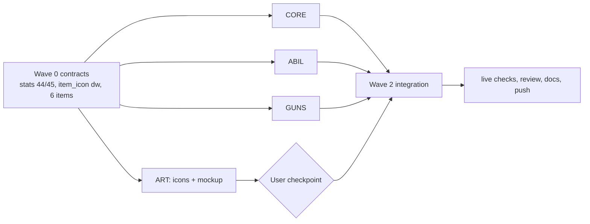

# AssemblyCraft 0.10.4 "Marksman": archetype rebalance, a fifth archetype for firearms, gun scaling, attachments and two new guns

## Context

**What the user asked for** (French, 2026-11-09):
- The archetype balance is broken: the Mage ends up rolling over everything. The other archetypes must get stronger so they are at least as useful as the Mage.
- Add a "Marksman" branch for firearms, placed between the Mage and the Rogue. It may come with new guns or attachments to improve them.

**Decisions the user made** (form answers):
- Ring order, clockwise from north: **Warrior · Mage · Marksman · Rogue · Archer**.
- Guns stay usable by everyone. Bullets now go through the normal damage pipeline (crits, % damage). Only the Marksman gets the firearm stats that make them scale.
- This release ships **attachments** and **two new guns**.
- Rebalance: buff Warrior, Archer and Rogue, **and** trim the Mage's two excesses: flat adds stacking on the staff bolt, and the shock +30%.

**Findings that drive the numbers** (read from the code, DPS derived with the throwaway model in Verification):
- Staff bolt: auto-fire on held LMB, ~67-block range, no ammo, `SRC_BOLT` counts as a weapon attack, so `WEAPON_DMG` and every `ADD_*` flat add (Fire Touch, Runed Steel, Charged Tips) multiply by F and by the element bonus on a base of 4. Each bolt adds a shock stack; 3 stacks make the mob take +30% from every source. Single-target DPS of a pure Mage build: L25 90, L50 173 with a staff and 289 with the Archmage Staff.
- Archer: about half the Mage (L25 43–61, L50 117). Volley, Barrage extras and Arrow Rain arrows are refused by the mob's 10-step hurt window, so only ~1 arrow of a volley counts.
- Warrior and Rogue: high raw melee DPS (L50 ~120–135 click-bound) but no range, little crowd control, low survivability.
- Guns: `arrows.asm:335` `.bullet_hit` calls `mob_strike` with the raw `g_damage` ("guns take no stats"). No stat, crit or keystone touches a bullet; a level-50 zombie has 167 HP.
- A gun keeps its loaded rounds in `ITEMSTACK.dmg`; the other 8 bits of that word are free for attachments. Item ids 225..255 are free. `item_icon` is a byte table and byte tiles are exhausted (only 230, 231 are free).

**End state:**
- 5 archetypes on a 5-sector web: 110 nodes (5 paths, 90 archetype nodes, 15 bridges), 130 edges, 20 abilities, 15 keystones. Old 0.10.2/0.10.3 worlds load with skill points refunded, kits never re-given.
- Bullets and grenades scale with the new stats `GUN_DMG` and `RELOAD_SPEED`, crit, `ALL_DMG`, elite damage, statuses and resistances.
- 4 attachments fixed onto a gun in any crafting grid; Revolver and Hunting Rifle.
- Rebalanced numbers per the tables below. `make test` green, warning-free build, live-checked in omabox.

**Repo:** `/run/media/octopusman/Games/Experiences/assemblycraft` (x86-64 NASM, branch `master`, HEAD `4766f99` "0.10.3 sound: mix by loudness, not peak" or later, remote `origin` = private `BaLaurent/assemblycraft`). Last shipped version string: "AssemblyCraft 0.10.3" (`menus.asm:111 t_version`, `hud.asm:65 s_dbg_title`).

## Conventions (all waves)

- Each `.asm` file: `%include "common.inc"`, `default rel`, explicit sections, its own `extern`/`global` lines, SysV ABI (rsp 16-aligned at every call; rbx/rbp/r12–r15 callee-saved), a header comment with signature and contract on every new or changed function, byte ids loaded with `movzx`.
- A test is `test_<name>() → eax` (0 = pass), registered in `src/selftest.asm` (an `extern`, a `TEST` row and a `TESTNAME` row, appended in the order of this doc). Every new assertion gets a negative control: break the code once in a scratch copy, see the test fail, restore.
- Workers work in scratch copies: `REPO=/run/media/octopusman/Games/Experiences/assemblycraft; rm -rf /tmp/ac104-<w> /tmp/ac104-<w>-base && mkdir -p /tmp/ac104-<w> && rsync -a --exclude build --exclude .git --exclude .omp $REPO/ /tmp/ac104-<w>/ && rsync -a $REPO/src/ /tmp/ac104-<w>-base/`. They never run git, copy back nothing themselves, may hack any file in their scratch to build, put fakes of sibling symbols in `src/zz_stub.asm` (never copied back), and report: owned files, `selftest.asm` lines, `common.inc` hunks (as a unified diff against the base), `make test` tail, stubs, deviations, negative controls, unowned call sites needing wiring. The integrator copies back owned files only, after a `cmp` against the base, and applies the `common.inc` hunks by hand.
- Only the integrator runs git: one commit per step named below, `git push` after Wave 0 and at the end. Never add `.omp/` or `.asm-lsp.toml`.
- Build and suite: `make 2>&1 | grep -iE "warn|error"` prints nothing; `make test` ends with `selftest: N passed, 0 failed`.
- Live checks use omabox from `$HOME`: `omabox up --audio`; install with `H=$(omabox -b default path --home); cp build/assemblycraft "$H/.ac.new" && mv -f "$H/.ac.new" "$H/assemblycraft"`; launch with `omabox -b default run -d --wait -- /home/sbx/assemblycraft --data-dir /home/sbx/acv104 --play NAME [--creative --seed N]`; capture with `omabox -b default shot --window assemblycraft --fit 960`. Mouse look does not reach the game in a box; clicks and keys do. The header patcher `/tmp/acpatch9.py` has the ops `level=N` (byte at `WORLDHDR.rpg + RPGSAVE.level`) and `slot=` (inventory stacks); if it is missing, rewrite it from `struc WORLDHDR` in `common.inc`.

## Contracts (Wave 0 writes these; every worker codes against them)

### `src/common.inc` additions

Additive in Wave 0 (nothing existing changes value except `NUM_STATS` and `NUM_ITEMS`):

|Name|Value|Meaning|
|---|---|---|
|`ARCH_MARKSMAN`|5|fifth archetype id (Warrior 1, Mage 2, Archer 3, Rogue 4 keep their ids)|
|`ABIL_GRENADE` / `ABIL_BULLSEYE` / `ABIL_FANHAMMER` / `ABIL_FLASHBANG`|16 / 17 / 18 / 19|Marksman abilities, id = (5 − 1)·4 + slot|
|`KS_DEADSHOT` / `KS_QUARTERMASTER` / `KS_POWDER_KEG`|12 / 13 / 14|Marksman keystones, id = (a − 1)·3 + branch|
|`STAT_GUN_DMG` / `STAT_RELOAD_SPEED`|44 / 45|`NUM_STATS` becomes 46|
|`SRC_GUN` / `SRC_GUN_SKILL`|7 / 8|bullets / grenades; family stat `STAT_GUN_DMG`; both above `SRC_BOLT`, so no flat adds|
|`PROJ_GRENADE`|6|lobbed powder charge (gravity like an arrow)|
|`AF_NOWIN` / `AF_FLASH`|32 / 64|arrow flags (bits 5, 6 are free): a bow arrow that ignores the hurt window (Barrage extras) / a grenade that flashes instead of exploding|
|`GUN_ROUNDS_MASK`|0x00FF|low byte of a gun's `ITEMSTACK.dmg`: rounds loaded|
|`ATT_SCOPE` / `ATT_EXTMAG` / `ATT_RIFLED` / `ATT_COMP`|0x100 / 0x200 / 0x400 / 0x800|attachment bits in a gun's `dmg`; bit = `0x100 << (id − SCOPE)`|
|`BOW_FULL`|11|bow damage at full draw (was 9); used by `game.asm`, `combat.asm` preview and `gear.asm` `ATK_BOW`|
|`WEB_SUB` / `WEB_EXTENT`|8 / 71|`WEBNODE.x/.y` are in 1/8 cell; every node lies within ±71|
|`REVOLVER` … `COMPENSATOR`|`FIRST_ITEM + 81` … `+ 86` (225 … 230)|order: `REVOLVER`, `HUNTING_RIFLE`, `SCOPE`, `EXTENDED_MAG`, `RIFLED_BARREL`, `COMPENSATOR`; `NUM_ITEMS` becomes `FIRST_ITEM + 87` (231)|
|`TILE_STAT_GUN` / `TILE_STAT_RELOAD`|230 / 231|stat icons (the last two free byte tiles; `STATINFO.icon` is a byte)|
|`TILE_CLASS_MARKSMAN`|352|Path of the Marksman emblem|
|`TILE_MK_ABIL0`|353|353 + slot: Powder Grenade, Bullseye, Fan the Hammer, Flashbang|
|`TILE_ICON_REVOLVER` … `TILE_ICON_COMP`|357 … 362|revolver, hunting rifle, scope, extended magazine, rifled barrel, compensator|

Flipped by Wave 1 owners (they report the hunks; the integrator applies them): `NUM_ARCHETYPES 5`, `NUM_ABILITIES 20`, `NUM_KEYSTONES 15`, `NUM_WEB_NODES 110` (comment "5 paths, 5×18 archetype nodes, 15 bridges"), `RPGX_VERSION 3` (CORE); `NUM_GUNS 7` (GUNS).

### Gun stack word

For a firearm stack, `ITEMSTACK.dmg` = `rounds | attachments`: bits 0–7 rounds loaded (≤ 255; the largest magazine is 68), bits 8–11 the `ATT_*` bits, bits 12–15 zero. Every reader masks with `GUN_ROUNDS_MASK`; every writer keeps the high byte. A plain gun (no attachment) keeps today's values, so 0.10.3 saves load unchanged.

### Cross-worker symbols

|Symbol|Owner (file)|Contract|
|---|---|---|
|`combat_bullseye_t`, `combat_fanhammer_t` (dd, global)|ABIL (`combat.asm`, inside the `combat_timers` … `combat_timers_end` block so `combat_step` ages them and `combat_reset` clears them)|steps left of Bullseye / Fan the Hammer; read by `guns.asm`|
|`ab_flash_at(xmm0 x, xmm1 y, xmm2 z)`|ABIL (`abilities.asm`)|the flashbang burst at a point (rules below); called by `arrows.asm`|
|`gun_magazine(edi id, esi dmg word) → eax`|GUNS (`guns.asm`)|replaces `gun_magazine(edi id)`: magazine with attachments and Quartermaster; 0 for a non-gun. Callers: `hud.asm`, `guns.asm`, tests|
|`gun_shot_info(edi id, esi dmg word, rdx out dword[4]) → eax 1/0`|GUNS (`guns.asm`)|out[0] base damage per pellet (Rifled Barrel applied; rocket launcher: 24), out[1] pellets, out[2] shot cooldown in steps (Compensator applied, not Fan the Hammer), out[3] 1 when the shot can crit (bullets), 0 (rocket); eax 0 for a non-gun|
|`explode_mob_mult` (dd float, global, default 1.0)|GUNS (`explode.asm`)|multiplies the mob damage of `explode_at`|
|`rpg_path_tile(edi archetype) → eax tile`|CORE (`rpg.asm`)|1..4 → `TILE_CLASS0 + a − 1`, 5 → `TILE_CLASS_MARKSMAN`, else 0|

## Design data

### Rebalance

|#|Change|Site|Before|After|
|---|---|---|---|---|
|M1|Mage: flat adds on the staff bolt|`calc_parts` flat-add block after the `cmp r12d, SRC_BOLT; ja .resist` gate (`combat.asm:899-917`)|`WEAPON_DMG·F` and every `ADD_x·F·elem_mult(x)` added in full|for `src == SRC_BOLT` only, those flat parts are multiplied by 0.5 before they join the element parts; melee and bow unchanged|
|M2|Mage: shock|`status.asm:33` `k_0_1` used by `status_damage_mult` (`:283-288`)|+10% damage taken per stack (cap 3 → +30%)|+5% per stack (+15%); rename the constant `k_shock_step dd 0.05`; fix the `:283` comment|
|M3|Mage: Charged Tips|the Mage–Archer bridge|`ADD_SHOCK` 1/rank on bolts|gone with the ring change (see Ring)|
|A1|Archer: bow damage|`game.asm` bow release (`:1999-2103`, the `8.0` in `1 + round(8·power)`), `combat.asm` preview base 9 (`:1805-1813`), `gear.asm` `ATK_BOW`/`ATK_CELESTIAL` (`:37-42`)|9 at full draw, Celestial 13|`1 + round(10·power)` = `BOW_FULL` 11 at full draw; Celestial = 11·3/2 the way the code already scales it; `ATK_BOW BOW_FULL`, `ATK_CELESTIAL (BOW_FULL*3/2)`|
|A2|Archer: path|`base_stats` row 3 `RANGED`|15|20|
|A3|Archer: Steady Aim|node 41|`RANGED_DMG` 6/rank|8/rank|
|A4|Archer: skill arrows|`arrows.asm:322-327` `.arrow`|every `PROJ_ARROW` gets `HITF_HURTWIN`, so 1 arrow of a Volley/Rain counts per 10 steps|only an `AF_ATTACK` arrow without `AF_NOWIN` gets `HITF_HURTWIN`. Volley, Arrow Rain and the two Barrage extras (`game.asm:2099`, add `AF_NOWIN` to their flags) all land|
|W1|Warrior: path|`base_stats` row 1|HP 24, `ARMOR_BONUS` 0|HP 28, `ARMOR_BONUS` 2|
|W2|Warrior: Iron Skin|node 13|1 armor/rank|2/rank|
|W3|Warrior: War Cry stun|`ab_warcry` (`abilities.asm:986-1050`: `cmp … MOB.stun, 20` and `mov … MOB.stun, 20`)|20 steps|40 steps, through a new `%define WARCRY_STUN 40` used by both lines|
|W4|Warrior: Charge|the Charge base float (`abilities.asm:134-137` region, the `6.0` `ab_charge_step` passes as base; confirm the label first)|6|10|
|R1|Rogue: backstab angle|`combat.asm:103` `k_m0_3`, used by `strike_backstab` (`:1388-1390` comment too)|mob faces away if dot < −0.3|dot < 0.0 (flank counts); rename `k_back_dot dd 0.0`|
|R2|Rogue: Fan of Knives|`KNIFE_DMG` (`abilities.asm:65-70`)|4|6|
|R3|Rogue: path|`base_stats` row 4 HP|20|24|
|R4|Rogue: Blade Mastery|node 63|`MELEE_DMG` 6/rank|8/rank|

Everything else keeps its value. The archetype rows of `base_stats` (columns HP, MELEE, RANGED, SPELL, CRIT, CRITDMG, MANA, MREGEN, STAM, SREGEN, ARMOR, SPEED, BACKSTAB, PARRY, LIFESTEAL, CD, ARROWSAVE, DODGE, then zeros, then `GUN_DMG`, `RELOAD_SPEED`):

|Row|Values|
|---|---|
|0 none|20, 0, 0, 0, 0, 0, 0, 0, 100, 0, 0, 0, 0, 0, 0, 0, 0, 0 … 0, 0|
|1 Warrior|**28**, 10, 0, 0, 5, 0, 0, 0, 120, 0, **2**, 0, 0, 0, 0, 0, 0, 0 … 0, 0|
|2 Mage|18, 0, 0, 10, 5, 0, 100, 4, 80, 0, 0, 0, 0, 0, 0, 0, 0, 0 … 0, 0|
|3 Archer|20, 0, **20**, 0, 8, 0, 0, 0, 100, 0, 0, 5, 0, 0, 0, 0, 10, 0 … 0, 0|
|4 Rogue|**24**, 0, 0, 0, 10, 0, 0, 0, 110, 10, 0, 5, 100, 0, 0, 0, 0, 0 … 0, 0|
|5 Marksman|20, 0, 0, 0, 8, 10, 0, 0, 100, 0, 0, 0, 0, 0, 0, 0, 10, 0 … **15, 15**|

Rows are written as 18 `dd` values, `times STAT_GUN_DMG - 18 dd 0`, then `dd <GUN_DMG>, <RELOAD_SPEED>` (`NUM_STATS` = 46 = `STAT_RELOAD_SPEED + 1`).

**Expected single-target DPS** (the hand model of the investigation: all attribute points in the primary attribute, skill points down the damage branch in tier order, un-elite zombie, 4 clicks/s for melee; Marksman = Dexterity, sustained fire including reloads; before/after):

|Level|Mage staff / Archmage|Warrior|Archer|Rogue|Marksman pistol / revolver / AK|
|---|---|---|---|---|---|
|10|22 / 52 → 20 / 46|59 → 59|19 → 25|33 → 33|— → 24 / 36 / 66|
|25|90 / 159 → 57 / 110|99 → 99|61 → 76|84 → 87|— → 42 / 62 / 114|
|50|217 / 347 → 102 / 188|134 → 134|117 → 141|119 → 123|— → 64 / 95 / 173|

The melee archetypes' share comes from survivability and control (W1–W4, R1–R3), not raw damage. These are first-pass numbers; the live checks may tune them (see Assumptions).

### Marksman archetype (a = 5)

- **Path of the Marksman** (node 4): kind `NODE_PATH`, `.stat` 5, max 1, level 1, icon `rpg_path_tile(5)`. Desc: "Guns and powder. Dexterity raises gun damage. Crit-hungry, fragile. Learns Powder Grenade." It adds row 5 − row 0 and teaches ability 16.
- **Dexterity:** in `rpg_recompute`'s attribute block (`rpg.asm:1249-1263`), when `rpg_rank(ARCH_MARKSMAN − 1) > 0`, each Dexterity point also adds +1 `STAT_GUN_DMG`. Without the path, Dexterity gives no gun damage. The attribute text (`rpg.asm:131`) is unchanged.
- **Kit** (`kit_tab` 5th entry `kit_marksman`): `PISTOL` 1, `PISTOL_ROUND` 32 (the pistol arrives unloaded; R reloads it). Kit bit 4 of `RPGEXT.kits`.
- **Gear:** `arch_family[5] = FAM_DAGGER`, `t_legendary[5] = SHADOW_FANG` (`gear.asm:164-166`; guns are not gear).
- **Nodes** (id = 5 + 4·18 + n = 77 + n; same pattern as every archetype: abilities at n 7, 9, 15, keystones at n 5, 11, 17; stat nodes max 5, others max 1; levels by tier 1, 4, 9, 15, 22, 30):

|n|id|Branch, tier|Name|Kind|Stat / id|Value/rank|
|---|---|---|---|---|---|---|
|0|77|Gunslinger 0|Steady Hands|stat|`GUN_DMG`|6|
|1|78|Gunslinger 1|Trigger Discipline|stat|`CRIT_CHANCE`|3|
|2|79|Gunslinger 2|Hollow Points|stat|`CRIT_DMG`|15|
|3|80|Gunslinger 3|Bounty Hunter|stat|`ELITE_DMG`|6|
|4|81|Gunslinger 4|Fast Hands|stat|`RELOAD_SPEED`|8|
|5|82|Gunslinger 5|Deadshot|keystone|`KS_DEADSHOT`|—|
|6|83|Quartermaster 0|Bandolier|stat|`ARROW_SAVE`|8|
|7|84|Quartermaster 1|Bullseye|ability|17|—|
|8|85|Quartermaster 2|Speed Loader|stat|`RELOAD_SPEED`|8|
|9|86|Quartermaster 3|Fan the Hammer|ability|18|—|
|10|87|Quartermaster 4|Tinkerer|stat|`COOLDOWN_RED`|4|
|11|88|Quartermaster 5|Quartermaster|keystone|`KS_QUARTERMASTER`|—|
|12|89|Demolitions 0|Vitality|stat|`MAX_HEALTH`|3|
|13|90|Demolitions 1|Powder Burns|stat|`FIRE_DMG`|8|
|14|91|Demolitions 2|Blast Radius|stat|`AREA`|8|
|15|92|Demolitions 3|Flashbang|ability|19|—|
|16|93|Demolitions 4|Leather Coat|stat|`ARMOR_BONUS`|1|
|17|94|Demolitions 5|Powder Keg|keystone|`KS_POWDER_KEG`|—|

- **Abilities** (`abil_tab` rows 16..19, all `RES_STAMINA`):

|Id|Label|Name|Desc|Cost|Cooldown s|Effect|
|---|---|---|---|---|---|---|
|16|`grenade`|Powder Grenade|Lob a grenade that bursts into flame|30|8|`ab_shoot(eye, dir, offset 0.5, speed 20.0, dmg GRENADE_DMG 12, PROJ_GRENADE, flags ab_crit())`, then `audio_play(SND_BOW, k_vol)`|
|17|`bullseye`|Bullseye|Shots fly true and crit more|20|15|`combat_bullseye_t = BULLSEYE_STEPS 300`; `ab_burst(FX_GOLD, 16, 3.0)`; `SND_SPELL`|
|18|`fanhammer`|Fan the Hammer|Fire twice as fast, rounds are free|50|30|`combat_fanhammer_t = FANHAMMER_STEPS 240`; `ab_burst(FX_SPARK, 20, 3.0)`; `SND_WARCRY`|
|19|`flashbang`|Flashbang|Throw a flash that stuns foes|35|12|`ab_shoot(eye, dir, 0.5, 20.0, dmg 0, PROJ_GRENADE, AF_FLASH)`, then `SND_BOW`|

  None has a plan stage (they go straight to `.pay` in `abilities_use`), and none needs a gun in hand: Bullseye and Fan the Hammer only change shots fired while their timer runs. Their bodies copy `ab_explosive` (16, 19) and `ab_blade` (17, 18).
- **`ab_flash_at(point)`:** radius `FLASH_R 5.0 · ab_mult(STAT_AREA)`, ×1.5 with `KS_POWDER_KEG`. Copy `ab_warcry`'s mob loop (`abilities.asm:1005-1038`) with the point as centre: a live mob whose body middle (`y + height·0.5`) is within the radius, not `AFX_JUGGERNAUT`, `mob_is_hostile`, gets `MOB.stun = max(MOB.stun, s)` with s = `FLASH_STUN_BOSS 20` for `MOB_BOSS` and `FLASH_STUN 60` otherwise (the boss test as `ab_slam` does it at `:1100-1103`). Then `fx_burst(point, FX_GOLD, 40, 6.0)` and `audio_play(SND_EXPLODE, 0.6)`. No damage.
- **Keystones:**

|Id|Name|Desc (node tooltip)|Rule|
|---|---|---|---|
|12|Deadshot|Aimed shots always crit. Shots from the hip never crit.|in `gun_fire`: `game_aim ≥ 0.9` → crit forced; else no crit|
|13|Quartermaster|Your magazines hold 50% more rounds.|`gun_magazine`: one more `ceil(m·3/2)` step|
|14|Powder Keg|Grenade, flashbang and rocket blasts are 50% wider.|grenade burst radius, `ab_flash_at` radius and the rocket radius ×1.5|

### Ring, titles, bridges, node ids, edges

- **Ring** (clockwise, ring position p = 0..4, sector angle 72·p degrees from north, screen y down): Warrior p0, Mage p1, Marksman p2, Rogue p3, Archer p4. `next(a)`: Warrior→Mage, Mage→Marksman, Marksman→Rogue, Rogue→Archer, Archer→Warrior.
- **Names and titles:** `arch_names` gains "Marksman". `pair_titles` becomes 25 qwords indexed `(lo − 1)·5 + (hi − 1)` (unused cells 0): {1,2} Spellblade, {1,3} Warden, {1,4} Duelist, {1,5} Grenadier, {2,3} Arcane Archer, {2,4} Nightblade, {2,5} Spellslinger, {3,4} Skirmisher, {3,5} Sharpshooter, {4,5} Gunslinger. The title rule (`2·s2 ≥ s1`) is unchanged.
- **Node ids:** path of archetype a = a − 1 (0..4); archetype node n of a = 5 + (a − 1)·18 + n (5..94); bridge k owned by a = 95 + (a − 1)·3 + k (95..109). Every former archetype node id n (4..75) becomes n + 1.
- **Bridges** (max 3, `.arch` 0, levels 4 / 15 / 30 for k 0 / 1 / 2):

|Owner a → next|Ids|k 0|k 1|k 2|
|---|---|---|---|---|
|Warrior → Mage|95–97|Runed Steel, `ADD_FIRE` 1|Warded Plate, `MAX_MANA` 10|Spellblade, `ALL_DMG` 4|
|Mage → Marksman|98–100|Alchemist's Powder, `FIRE_DMG` 6|Far Sight, `AREA` 6|Spellslinger, `ALL_DMG` 4|
|Archer → Warrior|101–103|Riposte Edge, `CRIT_CHANCE` 2|Scarred Hide, `THORNS` 2|Warden, `WEAPON_DMG` 5|
|Rogue → Archer|104–106|Barbed Shafts, `BLEED_CHANCE` 6|Light Step, `MOVE_SPEED` 3|Skirmisher, `ATTACK_SPEED` 4|
|Marksman → Rogue|107–109|Cold Read, `CRIT_CHANCE` 2|Light Fingers, `DODGE_COST` 8|Gunslinger, `CRIT_DMG` 10|

  Old bridges map as: 76–78 → 95–97; 79–81 (Charged Tips, Far Sight, Starshot) are deleted (Far Sight's stat moves to 99); 82–84 → 104–106 (now owned by the Rogue); 85–86 → 101–102; 87 Duelist → 103 renamed Warden.
- **Edges (130):** for each a: path(a) – (a, b, 0) for b 0..2; (a, b, t) – (a, b, t + 1); bridge(a, k) – (a, branch 2, tier 2k + 1); bridge(a, k) – (next(a), branch 0, tier 2k + 1); bridge(a, k) – bridge(a, k + 1). The `%rep NUM_ARCHETYPES` generator (`rpg.asm:462-499`) computes `next(a)` with an `%if` chain on the table above instead of `wx_a mod 4`, uses base 5 instead of 4, and checks `130 * 4` bytes.

### Web layout

Units are 1/8 cell (`WEB_SUB`), screen axes, y down. Path at radius 2 cells, tier t at 3.4 + 1.1·t, branch b at angle (b − 1)·20° off the sector axis, bridge k at the radius of tier 2k + 1 on the sector boundary (+36°); x = round(8·r·sin θ), y = round(−8·r·cos θ). Checked: all within ±71; at zoom 1 (×28/8) and zoom 0 (×8/8) no two pick boxes (half 11 / path 14, and 3 / path 5) come within 1 unit; no edge passes within 0.6 cell of a third node. `WREC` takes the (x, y) of each row explicitly; the `WCELL` macro is deleted.

|Ids|Coordinates (in id order)|
|---|---|
|0–4 paths (W, Ma, A, R, Mk)|(0,−16) (15,−5) (−15,−5) (−9,13) (9,13)|
|5–22 Warrior n0..17|(−9,−26) (−12,−34) (−15,−42) (−18,−50) (−21,−59) (−24,−67) (0,−27) (0,−36) (0,−45) (0,−54) (0,−62) (0,−71) (9,−26) (12,−34) (15,−42) (18,−50) (21,−59) (24,−67)|
|23–40 Mage|(21,−17) (28,−22) (35,−28) (42,−33) (49,−38) (56,−44) (26,−8) (34,−11) (43,−14) (51,−17) (59,−19) (68,−22) (27,1) (36,1) (45,2) (54,2) (62,2) (71,2)|
|41–58 Archer|(−27,1) (−36,1) (−45,2) (−54,2) (−62,2) (−71,2) (−26,−8) (−34,−11) (−43,−14) (−51,−17) (−59,−19) (−68,−22) (−21,−17) (−28,−22) (−35,−28) (−42,−33) (−49,−38) (−56,−44)|
|59–76 Rogue|(−7,26) (−10,35) (−12,43) (−15,52) (−17,60) (−20,68) (−16,22) (−21,29) (−26,36) (−32,43) (−37,50) (−42,58) (−23,15) (−30,20) (−37,25) (−44,30) (−52,35) (−59,40)|
|77–94 Marksman|(23,15) (30,20) (37,25) (44,30) (52,35) (59,40) (16,22) (21,29) (26,36) (32,43) (37,50) (42,58) (7,26) (10,35) (12,43) (15,52) (17,60) (20,68)|
|95–97 W→Ma|(21,−29) (32,−43) (42,−58)|
|98–100 Ma→Mk|(34,11) (51,17) (68,22)|
|101–103 A→W|(−21,−29) (−32,−43) (−42,−58)|
|104–106 R→A|(−34,11) (−51,17) (−68,22)|
|107–109 Mk→R|(0,36) (0,54) (0,71)|

### Grimoire screen (`rpgscreens.asm`)

- `WEB_CELL1 28` stays; `WEB_CELL0` 9 → 8. `web_node_xy`: dx = (x · pitch) `sar` 3, dy likewise. `web_dims_tab` unchanged.
- `web_clamp` (`:829-859`): the `imul ecx, ecx, 7` (7 cells) becomes the limit `((WEB_EXTENT − WEB_SUB) · pitch) sar 3` (220 at zoom 1, 63 at zoom 0). Fix the "17 x 17" comments (`:690-696`, `:829-830`, `:56-57`, `:225`).
- Archetype labels (`web_draw_compass`, `:1097-1165`, zoom 1 only as today): replace the `ARCH_*` if-chain with a side table indexed a − 1: Warrior right (`x = cx + 19, y = cy − 4`), Mage below (`x = cx − w/2, y = cy + 17`), Archer above, Rogue above, Marksman above (`x = cx − w/2, y = cy − 25`). The loop runs a = 1..`NUM_ARCHETYPES`.
- Path icon (`:1250-1252`): `rpg_path_tile(.stat)`.
- Zoom-about-mouse (`:882-914`) already scales by the pitch ratio; unchanged.

### Firearm rules (`guns.asm`, `arrows.asm`, `explode.asm`)

Per gun index g (lookup below), with w the stack's dmg word, rounds = w & `GUN_ROUNDS_MASK`, aim = `game_aim` (global float in `game.asm`):
- **Lookup:** `gun_index(id)` = id − `PISTOL` for `PISTOL..ROCKET_LAUNCHER` (0..4), 5 for `REVOLVER`, 6 for `HUNTING_RIFLE`, else −1. `held_gun` (`guns.asm:105-117`), `hand.asm:229-231` and `gunmodel.asm:106-108` call `gun_index` instead of their inline `id − PISTOL` tests.
- **Magazine** `gun_magazine(id, w)`: m = `g_mag[g]`; with `ATT_EXTMAG` m = (3m + 1)/2; with `KS_QUARTERMASTER` once more m = (3m + 1)/2. Pistol 8 → 12 → 18; AK 30 → 45 → 68.
- **Damage per pellet:** d = `g_damage[g]`; with `ATT_RIFLED` and d > 0, d += max(1, d/4). **Speed:** `g_speed[g]` ×1.3 with `ATT_RIFLED`.
- **Cooldown:** c = `g_cooldown[g]`; with `ATT_COMP` c = max(2, (3c + 2)/4); while `combat_fanhammer_t > 0` c = max(2, c/2). `ATTACK_SPEED` never applies to guns.
- **Spread:** s = `g_spread[g]` · scale (the `xmm0` argument, unchanged contract); with `ATT_COMP` s ×0.5; s = 0 while `combat_bullseye_t > 0`, or with `ATT_SCOPE` and aim ≥ 0.9.
- **Crit** (one roll per shot, all pellets share it): with `KS_DEADSHOT`, crit = (aim ≥ 0.9). Otherwise chance = `rpg_stats[STAT_CRIT_CHANCE]` + 25 while Bullseye + 15 with `ATT_SCOPE` and aim ≥ 0.9, capped 100; crit = `rng_next % 100 < chance`. A crit sets `AF_CRIT` in the `arrows_spawn` flags (`guns.asm:350`, today `xor r8d, r8d`).
- **Rounds:** a shot decrements rounds (keeping the high byte) unless `combat_fanhammer_t > 0`. The empty test (`:278`) and the reload test (`:134`) use the masked rounds and `gun_magazine(id, w)`.
- **Reload length:** steps = max(10, (`g_reload[g]`·100 + (100 + R)/2) / (100 + R)) with R = `rpg_stats[STAT_RELOAD_SPEED]`, stored in `gun_reload` and `gun_reload_total`.
- **Reload refill** (`gun_step`, `:199-215`): Creative sets rounds = magazine. Survival repeats need = magazine − rounds times: stop when `inv_count(ammo) = 0`; if `rng_next % 100 < rpg_stats[STAT_ARROW_SAVE]` the round loads without leaving the inventory (`ARROW_SAVE` is "ammo saved"; its `stat_tab` suffix becomes "% ammo saved"), else `inv_remove_one(ammo)` then it loads. Write back `(w & 0xFF00) | rounds`.
- **Bullet hit** (`arrows.asm`): delete `.bullet_hit` (`:335-347`). `PROJ_BULLET` joins the shared block at `:300` with `esi = SRC_GUN`, element from the flags (physical), `HITF_CRIT` from `AF_CRIT`, no `HITF_HURTWIN` (so `combat_hit_mob` uses `mob_strike` and every bullet counts). `calc_parts` (ABIL) gives `SRC_GUN`/`SRC_GUN_SKILL` the family stat `STAT_GUN_DMG`; they get no bleed roll, no Executioner, no Inferno, no flat adds.
- **Grenade** `PROJ_GRENADE`: gravity as `PROJ_ARROW` (`:232-236`), `max_age` 120 (append to the `:64` table), player-owned only. On a mob hit, on a block (burst at t − 0.05 like the rocket, `:518`) and at expiry, `.grenade_burst`: `live = 0`; with `AF_FLASH` call `ab_flash_at(hit point)`; else `explode_magic(hit point, 3.0 ×1.5 with KS_POWDER_KEG, ARROWENT.damage, SRC_GUN_SKILL, ELEM_FIRE | HITF_CRIT if AF_CRIT)`. Drawn as a box (−0.1,−0.1,−0.1)–(0.1,0.1,0.1), all faces `TILE_TNT_SIDE`, next to the bullet case (`:729`).
- **Rocket** (`.rocket_burst`, `:523-530`): before `explode_at`, `explode_mob_mult = combat_calc(−1, SRC_GUN, 0, 1.0)` and radius `c_rocket_r` ×1.5 with `KS_POWDER_KEG`; after it, `explode_mob_mult = 1.0`. `explode_at` multiplies the mob damage by `explode_mob_mult` before its `roundss` (`explode.asm:565-588`). Player and block damage are unchanged.
- **Preview** (`combat_weapon_preview`, `combat.asm:1765`): first branch, when `gun_shot_info(held id, held dmg word, tmp)` returns 1: normal = round(`combat_calc(−1, SRC_GUN, 0, base)` · pellets); crit = out[3] ? round(`combat_calc(−1, SRC_GUN, HITF_CRIT, base)` · pellets) : normal; rate = round(600 / cooldown). The held stack is the selected hotbar `ITEMSTACK` (the one `strike_held` reads the id from).

### Guns and attachments

|g|Gun|Ammo|Mag|Damage/pellet|Pellets|Cooldown|Reload|Spread|Speed|Kind|Sound|Auto|
|---|---|---|---|---|---|---|---|---|---|---|---|---|
|5|`REVOLVER` "Revolver"|`PISTOL_ROUND`|6|10|1|18|75|0.015|100.0|`PROJ_BULLET`|`SND_PISTOL`|0|
|6|`HUNTING_RIFLE` "Hunting Rifle"|`RIFLE_ROUND`|5|22|1|40|120|0.0|140.0|`PROJ_BULLET`|`SND_MUSKET`|0|

Guns 0–4 keep their table values. Models (`gunmodel.asm`, appended to `models`, `muzzle_z`, `muzzle_y`):

```
revolver:
    PART -0.03, 0.01, -0.3,    0.03, 0.06, -0.12,   C_METAL ; barrel
    PART -0.045, -0.01, -0.12, 0.045, 0.07, 0.0,    C_DARK  ; cylinder
    PART -0.03, 0.0, 0.0,      0.03, 0.06, 0.04,    C_METAL ; frame
    PART -0.03, -0.17, 0.0,    0.03, 0.0, 0.06,     C_WOOD  ; grip
    PART -0.012, -0.05, -0.09, 0.012, 0.0, -0.03,   C_DARK  ; trigger guard
    dd END
hrifle:
    PART -0.016, 0.03, -1.0,   0.016, 0.065, -0.3,  C_METAL ; barrel
    PART -0.04, -0.02, -0.7,   0.04, 0.04, -0.2,    C_WOOD  ; fore-stock
    PART -0.04, -0.02, -0.2,   0.04, 0.07, 0.1,     C_DARK  ; receiver
    PART -0.022, 0.075, -0.32, 0.022, 0.115, -0.02, C_DARK  ; scope tube
    PART -0.045, -0.15, 0.08,  0.045, 0.04, 0.42,   C_WOOD  ; butt
    dd END
; muzzle_z -0.31, -1.01   muzzle_y 0.035, 0.047
```

Attachments have no 3D part. Item tables (`itemdefs.asm`): the 6 new ids get names "Revolver", "Hunting Rifle", "Scope", "Extended Magazine", "Rifled Barrel", "Compensator"; icons `TILE_ICON_*`; `item_max_stack` 1 for the two guns, 16 for the attachments; every other table keeps its default.

Recipes (shaped, appended to `recipes`, `I` = `IRON_INGOT`; none collides with an existing shape):

|Output|Shape (w × h, rows)|
|---|---|
|`REVOLVER` ×1|3×2 `I I GOLD_INGOT / 0 PLANKS 0`|
|`HUNTING_RIFLE` ×1|3×2 `I I I / PLANKS PLANKS GLASS_PANE`|
|`SCOPE` ×1|3×1 `I GLASS_PANE I`|
|`EXTENDED_MAG` ×1|1×3 `I / GOLD_INGOT / I`|
|`RIFLED_BARREL` ×1|3×1 `I I DIAMOND`|
|`COMPENSATOR` ×1|3×1 `FLINT I FLINT`|

**Fitting an attachment** (`craft_update`, `items.asm:431-527`, both grids): when the table is exhausted (`.rec: cmp rbx, r9; jae .empty`, `:480-481`, now `jae .attach`), scan the active cells the bounding-box pass visits. Exactly two non-empty cells, one with `gun_index(id) ≥ 0` and one with id in `SCOPE..COMPENSATOR`, and the gun's word without that attachment's bit → `inv.result` = gun id | 1 << 8 | ((w | bit) << 16). Anything else → `.empty`. Taking the result consumes both (`craft_consume` as today). The shift-click result path (`:1192`) loads `r8d` from `word [result + 2]` instead of 0. Attachments are permanent; the recipe book does not show the fitting.

**Tooltips** (`item_tooltip`, `gear.asm:1252`, plain-item path after the name line `:1292`):
- a gun: one `COL_AFFIX` line per set bit, in bit order: "Scope: no spread aimed, +15% crit aimed", "Extended magazine: +50% rounds", "Rifled barrel: +25% damage, faster bullets", "Compensator: fires 25% faster, less spread";
- an attachment item: its own line from that list in `COL_AFFIX`, then "Craft it with a gun to fit it" in the colour of the "Shift: compare" line.

**HUD** (`hud.asm:884-947`): the ammo text uses the masked rounds and `gun_magazine(id, w)`.

### Save migration (`rpg_load`, `rpg.asm:1902-2011`)

- `RPGX_VERSION` 3. Version 0 or 1: today's legacy branch, then version 3.
- Version 2 (0.10.2 / 0.10.3 worlds): keep `.kits` and `.attr`; `web_clear`; zero `.bar`; version 3; set `rpg_migrated`; banner "New Marksman path: skill points refunded".
- Version 3: today's `web_valid` path.

## Approach



### Wave 0 — contracts (integrator, inline; commit "0.10.4 contracts: Marksman ids, gun stats, wide item icons, six new items")

1. `git status` clean apart from `.omp/` and `.asm-lsp.toml`; HEAD `4766f99` or later. Baseline: `make test` → 187 passed.
2. Copy this plan to `docs/superpowers/specs/2026-11-09-assemblycraft-marksman-design.md`.
3. `common.inc`: every addition of the Contracts table, the item ids with `NUM_ITEMS (FIRST_ITEM + 87)`, `NUM_STATS 46`.
4. The two stats end to end:
   - `rpg.asm` `stat_tab` rows 44, 45: `STATI "Gun damage", "% gun damage", FMT_PCT, TILE_STAT_GUN` and `STATI "Reload speed", "% reload speed", FMT_PCT, TILE_STAT_RELOAD`.
   - `rpgscreens.asm` `sheet_order` (`:100-114`): `STAT_GUN_DMG` right after `STAT_SPELL_DMG`, `STAT_RELOAD_SPEED` right after `STAT_ATTACK_SPEED` (both Offense).
   - `test_rpg.asm` `exp_stats` (`:140-185`): the two rows, formatted "+7% gun damage" / "+7% reload speed" the way the other `FMT_PCT` rows are.
   - `base_stats` rows and the test `exp_paths` rows already pad with `times NUM_STATS - 18`.
5. `item_icon` `db` → `dw`: `itemdefs.asm:234-281` (`PAD_TO … 2, 0`, `END_TABLE item_icon, 2, 0`, every `db` row and `%rep` body to `dw`); readers `ui.asm:1060`, `itemmodel.asm:153`, `recipebook.asm:918-919` (word loads with index ×2); `test_items.asm:1246, 1249, 1337, 1474-1475` (word loads; `tb_rows` +34 stays a byte, compared after `movzx`).
6. The six items in every `itemdefs.asm` table per "Guns and attachments" (names, icons, max stack). No recipes or gun behaviour yet.
7. Build warning-free, `make test` 187/187, commit, `git push`.

### Wave 1 — four parallel workers (one `task` batch, scratch copies made after Wave 0)

**ART** (owns `texgen.asm` and throwaway files under `/tmp/ac104-mock/`):
1. Draw 13 icons with draw-free `BMP tile, bitmap, palette` lines appended after the silhouette loop (`texgen.asm:1172-1180`) and before the font comment (`:1182`); bitmaps and palettes (16 rows × 16 chars, `PAL` lines, `dq 0`) near the end of the file like `charge_bmp`/`pal_charge`. Same pixel-art style as the existing ability icons:
   - 352 emblem: two crossed flintlock pistols over a gold ring;
   - 353 Powder Grenade: black round bomb with a lit orange fuse;
   - 354 Bullseye: red and cream target rings with a dark centre;
   - 355 Fan the Hammer: a revolver with three gold motion lines;
   - 356 Flashbang: white starburst with a yellow core;
   - 357 Revolver, 358 Hunting Rifle (long wood stock, dark scope), 359 Scope (dark tube with blue lens), 360 Extended Magazine (tall brown magazine), 361 Rifled Barrel (grey barrel with a spiral highlight), 362 Compensator (short dark muzzle block with slots);
   - 230 gun damage (a brass bullet), 231 reload speed (a brass round inside a circular arrow).
2. Proof: an atlas dump (`/tmp/ac102-mock/dump.c` linked against the scratch build, as `build_dump.sh` does) is byte-identical to the Wave 0 atlas outside these 13 tiles.
3. Mockup: copy `/tmp/ac102-mock` to `/tmp/ac104-mock`; in `web.py` make 5 archetypes with the node tables, bridges, titles and the coordinates of "Web layout" (an explicit per-id table; the 4-rotation `cell()` goes); in `mock.py` node centre = coord · pitch >> 3 with pitch 28 / 8, zoom-0 node sizes 7 / 10, labels per the side table, ability tiles 353.. for Marksman. Render at GUI 426×240, ×3:
   - `grimoire.png`: zoom 1 centred on the compass; sample build Path of the Marksman + Steady Hands 3 + Trigger Discipline 1 + Path of the Rogue; Powder Grenade in Q, Bullseye in G;
   - `grimoire_overview.png`: zoom 0, same build;
   - `grimoire_tooltip.png`: hover on Path of the Marksman;
   - `icons.png`: the 13 tiles at 4× on parchment with their names;
   - `hud.png`: Revolver held, ammo text "6/9  [24]", Marksman abilities on the bar;
   - `sheet.png`, a contact sheet of the five.
4. Report the PNG paths. ART stops there; the integrator runs the checkpoint.

**CORE** (owns `rpg.asm`, `rpgscreens.asm`, `test_rpg.asm`, `test_hud.asm`, and the `common.inc` lines `NUM_ARCHETYPES`, `NUM_ABILITIES`, `NUM_KEYSTONES`, `NUM_WEB_NODES`, `RPGX_VERSION`):
1. Flip those five counts.
2. `web_tab`: 5 `PATHNODE` rows (Marksman last), `ARCHETYPE 1..5` blocks, `BRIDGES 1..5` blocks per "Ring" and "Marksman"; `WREC` gains explicit x, y arguments with the "Web layout" values; delete `WCELL`; size check `NUM_WEB_NODES * WEBNODE_size`. Edges per "Ring" (130). Rebalanced values per "Rebalance" (rows 1, 3, 4, new row 5; nodes 13, 41, 63). `ARROW_SAVE`'s `stat_tab` suffix "% ammo saved".
3. Tables: `abil_tab` rows 16..19; `kit_marksman` and `kit_tab` 5th entry; `arch_names` "Marksman"; `pair_titles` 25 entries; keystone `KNODE` names and descs; path desc.
4. Code:
   - `arch_sums` zeroes 6 dwords (add `mov [rdi+20], eax`);
   - `rpg_title` pair index `(lo − 1)·5 + (hi − 1)` (replace `shl eax, 2` at `:988`);
   - `rpg_ability_tile`: c = 4 → `TILE_MK_ABIL0 + s`;
   - new global `rpg_path_tile`;
   - Dexterity → `GUN_DMG` with the Marksman path, in `rpg_recompute`;
   - `rpg_load` per "Save migration";
   - every literal 4 that stands for "number of paths" becomes `NUM_ARCHETYPES`: the id comments (`rpg.asm:235-243`), the edge generator (`:462-499`), and the ability-node lookup in `rpg_ability_learned` (`:744-771`); check with `grep -nE "\b4\b" src/rpg.asm` around web ids.
5. `rpgscreens.asm` per "Grimoire screen".
6. Tests:
   - `test_rpg.asm`: `NUM_EDGES 130`; `WEBN(a,n)` = 5 + (a − 1)·18 + n; `:1468` `+4` → `+NUM_ARCHETYPES`; `exp_paths` (5 rows + none); `exp_bridges` (15); `exp_pairs` (10); `exp_abil` (20); `exp_ks` (15); the `exp_web` rows replaced by these (field order name, id, kind, stat, max, arch, value, x, y, level):

     |Id|Expected|
     |---|---|
     |0|Path of the Warrior, `NODE_PATH`, 1, 1, 1, 0, (0, −16), 1|
     |4|Path of the Marksman, `NODE_PATH`, 5, 1, 5, 0, (9, 13), 1|
     |5|Weapon Mastery, `NODE_STAT`, `STAT_MELEE_DMG`, 5, 1, 6, (−9, −26), 1|
     |30|Blink, `NODE_ABILITY`, 5, 1, 2, 0, (34, −11), 4|
     |41|Steady Aim, `NODE_STAT`, `STAT_RANGED_DMG`, 5, 3, 8, (−27, 1), 1|
     |64|Assassinate, `NODE_KEYSTONE`, `KS_ASSASSINATE`, 1, 4, 0, (−20, 68), 30|
     |86|Fan the Hammer, `NODE_ABILITY`, 18, 1, 5, 0, (32, 43), 15|
     |94|Powder Keg, `NODE_KEYSTONE`, `KS_POWDER_KEG`, 1, 5, 0, (20, 68), 30|
     |95|Runed Steel, `NODE_STAT`, `STAT_ADD_FIRE`, 3, 0, 1, (21, −29), 4|
     |109|Gunslinger, `NODE_STAT`, `STAT_CRIT_DMG`, 3, 0, 10, (0, 71), 30|

   - `web_cells_ok` (`:486-535`) becomes: every node within ±`WEB_EXTENT` and no two nodes share a coordinate pair. The pick-box separation is proven by `test_hud`'s `wv_rows` loop over every node at both zooms.
   - `test_rpg_skill_spend_rules`: same reasons with shifted ids; the bridge crossing now goes Warrior branch 2 tier 1 (id 18) → bridge 95 → Mage branch 0 tier 1 (id 24); a crossing Marksman → Rogue (ids 90 → 107 → 60) also returns 1.
   - `test_rpg_save_load_validates`: add a v2 header (version 2, kits `0x81`, attributes 3/0/0/0 at level 2, ranks on nodes 0 and 4 of the old layout) → after `rpg_load`: version 3, kits `0x81`, attributes kept, every web rank 0, bar empty, `rpg_migrated` set.
   - `test_hud.asm` `web_view_mapping` (`:671-695`): node 0 → (0, −56) at zoom 1 and (0, −16) at zoom 0; node 5 → (−32, −91) at zoom 1 (−9·28 sar 3, −26·28 sar 3) and (−9, −26) at zoom 0; the `wv_rows` loop unchanged.
   - New `test_marksman_path_and_dex` (in `test_rpg.asm`): level 1, `rpg_spend(4)` → 1; bar slot 0 = 16; inventory holds `PISTOL` ×1 and `PISTOL_ROUND` ×32; `rpg_stats[GUN_DMG]` = 15, `[RELOAD_SPEED]` = 15, `[CRIT_DMG]` = 10; at level 5 with Dexterity 10 poked into `RPGEXT.attr` and `rpg_recompute`, `GUN_DMG` = 25; then a second character (`rpg_reset`, level 5, the same Dexterity, `rpg_spend(2)` = Path of the Archer) has `GUN_DMG` 0 and `RANGED_DMG` 30; `rpg_title` with only Marksman ranks = "Marksman"; `rpg_path_tile(5)` = 352; `rpg_ability_tile(16..19)` = 353..356.

**ABIL** (owns `combat.asm`, `status.asm`, `abilities.asm`, `test_abilities.asm`, `test_melee.asm`, `test_status.asm`):
1. `calc_parts`: `SRC_GUN` and `SRC_GUN_SKILL` load `STAT_GUN_DMG` before `.family` (`combat.asm:849-866`; today any unknown source falls to spell); M1 (half flat adds for `SRC_BOLT`).
2. M2 in `status.asm`; R1 backstab threshold.
3. Timers `combat_bullseye_t`, `combat_fanhammer_t` (global) in the `combat_timers` block.
4. `combat_weapon_preview`: the gun branch per "Firearm rules"; the bow base becomes `BOW_FULL`.
5. `abilities.asm`: W3 (`WARCRY_STUN`), W4 (Charge 10), R2 (`KNIFE_DMG 6`); `ab_effects` rows 16..19 (`ab_grenade`, `ab_bullseye`, `ab_fanhammer`, `ab_flashbang`); global `ab_flash_at`; constants `GRENADE_DMG 12`, `BULLSEYE_STEPS 300`, `FANHAMMER_STEPS 240`, `FLASH_R 5.0`, `FLASH_STUN 60`, `FLASH_STUN_BOSS 20`.
6. Tests:
   - Update the pinned values, recomputing each from the new constants: Charge 10·1.1 → 11 (`test_abilities.asm:371-560`); War Cry stun 40 (`:1889-1959`); knives 6 (`:1287-1378`); preview bow and Celestial (`test_melee.asm:1481-1505`); Warrior `surv_max_health` 28 (`test_melee.asm:789`); every shock-dependent expectation; `test_damage_pipeline` `CALC` rows with flat adds on `SRC_BOLT`.
   - Literal web ids shift by +1 (`test_abilities.asm:2036, 2041` use 28 and 29 → 29 and 30); `:2097` `BAR_SET 0, 16, 0` → `NUM_ABILITIES`.
   - Add `CALC` rows: `SRC_BOLT` base 4 with `ADD_FIRE` 4 and all else 0 → 6.0 (4 + 0.5·4); `SRC_GUN` base 5 with `GUN_DMG` 60 → 8.0, with `SPELL_DMG` 100 instead → 5.0; shock 3 stacks → ×1.15.
   - New `test_marksman_abilities`: from the learned path, Powder Grenade spawns one `PROJ_GRENADE` with damage 12 and pays 30 stamina; Bullseye sets `combat_bullseye_t` 300 and Fan the Hammer `combat_fanhammer_t` 240; `ab_flash_at` at a zombie stuns it 60 steps, the Fallen King 20, a juggernaut 0, leaves a zombie 6 blocks away unstunned and never shortens a longer stun.

**GUNS** (owns `guns.asm`, `arrows.asm`, `explode.asm`, `gunmodel.asm`, `hand.asm`, `hud.asm`, `game.asm`, `items.asm`, `itemdefs.asm`, `gear.asm`, `test_guns.asm`, `test_items.asm`, `test_gear.asm`, `test_combat.asm`, and the `common.inc` line `NUM_GUNS`):
1. `NUM_GUNS 7`; the `g_*` tables and gunmodel tables gain the two guns; the lookup; the stack-word masking at every site (`guns.asm:134, 201, 204, 215, 278, 287`, `hand.asm:226-227`, `hud.asm:889`).
2. `gun_fire`, `gun_reload_start`, `gun_step`, `gun_magazine(id, w)`, `gun_shot_info` per "Firearm rules".
3. `arrows.asm`: bullet route, A4 (`.arrow`), `PROJ_GRENADE`, rocket scaling and radius; `explode.asm` `explode_mob_mult`.
4. `game.asm`: A1 (`8.0` → `10.0`, comment "BOW_FULL − 1"), `AF_NOWIN` on the Barrage extras (`:2099`).
5. `items.asm`: the six recipes, the fitting in `craft_update`, the shift-click result word.
6. `gear.asm`: tooltips per "Guns and attachments"; `ATK_BOW`/`ATK_CELESTIAL`; `arch_family`/`t_legendary` 6th entries.
7. Tests:
   - Keep the `test_guns.asm` expectations; give `test_bullet_hits_mob_and_stops` and `test_rifle_kills_zombie_point_blank` a cleared `rpg_stats` in their setup (the pipeline now reads it).
   - Add the six recipes to `craft_cases` (`test_items.asm:285-311`); update `test_gear.asm` "Attack 9/13" tooltips to `BOW_FULL` values and its archetype loop (`:1483-1485`) for archetype 5 → daggers.
   - New `test_bullet_damage_pipeline` (`test_guns.asm`): a 5-damage bullet into a 20 HP zombie with `rpg_stats[GUN_DMG]` 60 leaves 12; with `AF_CRIT` (crit damage 0) leaves 8; with `GUN_DMG` 0 and `SPELL_DMG` 100 leaves 15; two bullets 1 step apart both land.
   - New `test_gun_attachment_effects`: `gun_magazine(PISTOL, ATT_EXTMAG)` 12, 18 with `KS_QUARTERMASTER`; `gun_shot_info(PISTOL, ATT_RIFLED|ATT_COMP)` = {6, 1, 11, 1}; with `RELOAD_SPEED` 100 a pistol reload takes 30 steps; with `ARROW_SAVE` 100 a reload of 8 leaves the 8 rounds in the inventory; a shot under Fan the Hammer keeps rounds and sets cooldown 7; with Bullseye an aimed-off shotgun shot has zero spread; with `KS_DEADSHOT` and `game_aim` 1.0 every shot carries `AF_CRIT`, at 0.0 none does; a scoped pistol at `game_aim` 1.0 has zero spread; reload writes keep the attachment bits.
   - New `test_new_guns_fire`: `gun_index` of `REVOLVER`/`HUNTING_RIFLE` = 5/6 and of `STAFF` = −1; a loaded revolver fires one bullet of damage 10 and cools 18 steps; a hunting rifle bullet travels at 140 b/s; the HUD-facing `gun_magazine(REVOLVER, 0)` = 6.
   - New `test_attach_craft` (`test_items.asm`): 2×2 grid {`PISTOL` dmg 5, `SCOPE`} → result `STK(PISTOL, 1, 0x105)`; same in the 3×3 grid; {`PISTOL` dmg `0x105`, `SCOPE`} → 0; {`PISTOL`, `SCOPE`, `STICK`} → 0; plain click and shift-click on the result both deliver dmg `0x105` and empty the grid.
   - New `test_skill_arrows_ignore_hurt_window` (`test_combat.asm`): two skill arrows (no `AF_ATTACK`) 1 step apart into one zombie both deal damage; two `AF_ATTACK` arrows only one; with `AF_ATTACK|AF_NOWIN` both.

### Wave 2 — integration, checkpoint, live checks, review (integrator)

1. **Checkpoint (user):** show the ART PNGs with `ask`: "Valider la maquette" / "Modifier (décris)". On changes, ART edits the tiles or the integrator edits the label table / pitch numbers in this design doc and the mock, re-renders, asks again. Then commit "0.10.4 art: Marksman, gun and attachment icons" (texgen) with the approved PNGs copied to `docs/superpowers/specs/marksman-mockup/`.
2. Copy back CORE, ABIL, GUNS (owned files only), apply the `common.inc` hunks, register the 7 new tests in `selftest.asm` in this order: `marksman_path_and_dex`, `marksman_abilities`, `bullet_damage_pipeline`, `gun_attachment_effects`, `new_guns_fire`, `attach_craft`, `skill_arrows_ignore_hurt_window`. Remove every scratch stub. If the checkpoint changed label sides or pitch, apply them to `rpgscreens.asm` and `test_hud.asm`.
3. Set `menus.asm t_version` and `hud.asm s_dbg_title` to "AssemblyCraft 0.10.4". Build warning-free; `make test` → 194 passed, three runs in a row. Commits, in order: "0.10.4 core: five-archetype grimoire, Marksman path, rebalanced nodes, save v3"; "0.10.4 combat: gun damage family, mage trims, melee buffs, Marksman abilities"; "0.10.4 guns: bullets through the damage pipeline, attachments, revolver and hunting rifle".
4. **Live checks in omabox** on a new world `v104a` (seed 42), each with a screenshot (the grimoire ones side by side with their mockup PNG via `magick a.png b.png +append cmp.png`), looked at:
   - a. Grimoire zoom 1 and 0: 5 sectors, labels, Marksman icons; learn Path of the Marksman → pistol and 32 rounds, Powder Grenade in Q; R reloads to "8/8".
   - b. Patch `level=30`; spend Gunslinger to Deadshot and Quartermaster branch to Fan the Hammer; at night shoot zombies: damage numbers above 5, aimed shots all crit, hip shots never; Fan the Hammer keeps "N/12"; the character sheet shows the gun preview and "Gun damage", "Reload speed" rows.
   - c. Powder Grenade and Flashbang on a group: fire burst, stunned mobs.
   - d. Craft a scope and an extended magazine (patch the ingredients with `slot=`), fit both onto the pistol in the 2×2 grid: tooltip lines, ammo text "0/18" after Quartermaster; craft a revolver and a hunting rifle: held models, shots.
   - e. A Mage at level 30 vs a zombie: bolt numbers lower than on the 0.10.3 binary for the same build (run both); an Archer Volley at point blank shows several damage numbers.
   - f. A 0.10.3 world (copy any world from `acv102` or `acv103`): the refund banner, empty bar, kits not given twice.
   Fix what they find, with a regression assertion where a unit test can catch it; commit "0.10.4 tuning from live checks".
5. **Review:** two read-only `reviewer` subagents. R1: `rpg.asm`, `rpgscreens.asm`, `abilities.asm`, `combat.asm`, `status.asm` (migration, web ids and edges, title indexing, timers, stack alignment). R2: `guns.asm`, `arrows.asm`, `explode.asm`, `items.asm`, `gear.asm`, `hud.asm`, `hand.asm`, `gunmodel.asm`, `game.asm` (stack-word masking at every site, attach craft consumption, `explode_mob_mult` reset on every path, grenade lifetime). Fix crash, corruption and broken-feature findings with regression assertions.
6. Append "As built" and "Deferred" to the design doc; file every deferred item with `gh issue create -R BaLaurent/assemblycraft --label need-triage --label ready-for-human` and list the numbers there. Commit "0.10.4 sweep", `git push`.

## Critical files & anchors

- `src/rpg.asm`: `base_stats` (`:59-72`), `abil_tab` (`:213-232`), web macros and `web_tab` (`:245-460`), edge generator (`:462-499`), `pair_titles`/`arch_names` (`:510-529`), `rpg_ability_learned` (`:744-771`), `arch_sums`/`rpg_title` (`:861-997`), `rpg_ability_tile` (`:1018-1037`), `rpg_recompute` attributes (`:1249-1263`), `rpg_spend` kits (`:1573-1593`), `rpg_load` (`:1902-2011`).
- `src/combat.asm`: family selector (`:849-866`), flat-add block (`:899-917`), `combat_timers` (`:114-133`), `strike_backstab` (`:1388`), `combat_weapon_preview` (`:1765-1855`).
- `src/arrows.asm`: shared hit block and `.arrow` (`:298-334`), `.bullet_hit` (`:335-347`, deleted), `.magic_burst` (`:536-558`), `.rocket_burst` (`:523-530`), kind tables (`max_age :64`, gravity `:232-236`, draw `:729`).
- `src/guns.asm`: `g_*` tables (`:16-35`), `gun_index`/`held_gun` (`:50-117`), `gun_reload_start` (`:121`), `gun_step` (`:166-215`), `gun_fire` (`:257-372`).
- `src/items.asm`: `craft_update` (`:431-527`, hook at `:480-481`), shift-click result (`:1178-1200`, `r8d` at `:1192`).

## Verification

Prerequisites: `cd /run/media/octopusman/Games/Experiences/assemblycraft`, NASM, gcc, glfw, `make`. Live checks need omabox (`omabox up --audio` from `$HOME`) and `/tmp/acpatch9.py`.

1. Build and suite: `make clean && make 2>&1 | grep -iE "warn|error"` prints nothing; `make test` ends `selftest: 194 passed, 0 failed`, three runs in a row (Wave 0 alone: 187).
2. Clean cutover greps print nothing: `grep -nE "WCELL|\.bullet_hit|k_m0_3|NUM_GUNS 5" src/*.asm src/*.inc`; `grep -nE "lea +(eax|r13d), *\[r(di|bx)-PISTOL\]" src/*.asm` (the inline contiguity tests are gone).
3. New behaviour, headless (the new tests, each with a negative control):
   - A 5-damage bullet with `GUN_DMG` 60 into a 20 HP zombie leaves 12; with `SPELL_DMG` 100 instead it leaves 15.
   - Path of the Marksman at level 1 → bar slot 0 = 16, `PISTOL` and 32 `PISTOL_ROUND` in the inventory, `GUN_DMG` 15; Dexterity 10 → 25 with the path, 0 without it.
   - 2×2 grid {`PISTOL` dmg 5, `SCOPE`} → result word `0x105` (with the pistol id and count 1); fitting a second scope → no result.
   - `gun_magazine(PISTOL, ATT_EXTMAG)` = 12; 18 with Quartermaster.
   - A bolt base 4 with `ADD_FIRE` 4 computes 6 (was 8); shock 3 stacks multiplies by 1.15 (was 1.30).
   - Two skill arrows one step apart both hurt a zombie; two bow arrows only one.
   - A v2 save loads as v3 with kits and attributes kept and the web refunded.
4. Live: Wave 2 checks a–f with screenshots, the grimoire ones next to the approved mockup.

## Assumptions & contingencies

- **Version:** ships as "0.10.4"; the roadmap's 0.11 stays Quests.
- **Balance numbers** are a first pass from a hand DPS model. If a live check shows an archetype clearly off (for example the Archer still far behind the trimmed Mage at level 30), the integrator tunes only the values in the Rebalance and Marksman tables, updates their pinned tests in the same commit, and records the change under "As built".
- **Dexterity and guns:** only a Marksman (path taken) turns Dexterity into gun damage, so "only the Marksman scales guns" holds; gear crit and `ALL_DMG` affixes do reach everyone's bullets through the pipeline.
- **Mockup checkpoint:** CORE does not wait for it. If the user changes the label sides, pitch or node sizes, the integrator applies the new numbers after the merge. If `/tmp/ac102-mock` is gone, ART rebuilds a minimal compositor (atlas dump + PIL, nine-slice and font rules from `docs/superpowers/specs/2026-11-09-assemblycraft-grimoire-design.md`).
- **Tiles 230/231:** if the ART dump shows them already drawn, use `TILE_STAT0 + STAT_RANGED_DMG` for gun damage and `TILE_STAT_ASPD` for reload speed instead and leave 230/231 alone.
- **Old saves:** 0.10.2/0.10.3 worlds keep level, XP, attributes, gear, kits and quests; skill points are refunded once. Plain guns load unchanged.
- **omabox:** if `omabox up` dies, run `omabox down default` once and retry once; if it still dies, the live checks are reported blocked, the mockups stay the visual reference, and an issue is filed for them.

