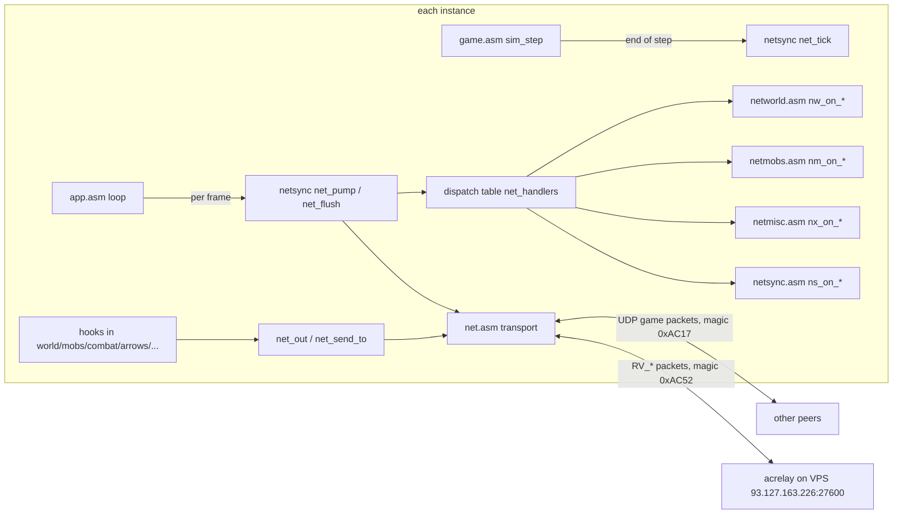

# AssemblyCraft 0.11 — Multiplayer: host-authoritative P2P for up to 8 players, NAT hole punching with a UDP rendezvous/relay, co-op with PvP, shared quests and reputation

## Context

The user wants peer-to-peer multiplayer in AssemblyCraft: x86-64 NASM, `master` at `adb3af3` (0.10.5), 207 selftests, about 115k lines. Today every system assumes one player through globals: `player`, `surv`, `inv`, `rpg_state`, `combat_*`, plus `mobs[]`, `drops[]` and `conts[]`.

Choices settled with the user:
- **Topology:** a player hosts the world they have open, and guests join that host directly. There is no dedicated game server, and the host is authoritative.
- **Reach:** UDP NAT hole punching through a rendezvous server, with a relay fallback. The server is a small static NASM binary deployed on the Hostinger VPS `93.127.163.226`, UDP port 27600. Direct `IP:port` join also works, for LAN or Tailscale.
- **Size and scope:** 8 players at most (host plus 7 guests). Full scope: co-op survival (mobs, projectiles, drops, chests), PvP, and shared quests and reputation.
- **PvP:** a host option, off by default.
- **Guest characters:** the host saves them in its world, keyed by player name.
- **Distance:** unlimited. The 64×64 toroidal column table becomes a hashed table, and the host keeps terrain and mobs alive around every player.

Design, fixed:
- Each peer simulates **its own player** with today's globals: body, survival, inventory, RPG, combat timers, abilities and its own projectiles.
- The **host owns the world**: blocks, mobs, drops, fire, TNT, containers, boats, time, sites, standing, the shared quest chain.
- On a guest, every action that would mutate a host-owned thing becomes a message to the host. The host applies it and replicates the result.
- The attacker computes damage from its own stats. The owner of the victim applies it.

End state:
- Two or more instances play together in one world: over the internet through the VPS (punch or relay), on a LAN, or by direct address. Each sees the others' avatars, block edits, mobs, drops, projectiles and chat.
- Guests' characters persist on the host. `make test` is green and the build is warning-free. The omabox two-instance checks and the VPS checks in Verification pass.

## Decisions (fixed; workers do not revisit them)

- **Version and doc:** the version string becomes `0.11.0` (`hud.asm:68` `s_dbg_title`, `menus.asm:111` `t_version`). This plan is copied to `docs/superpowers/specs/2026-11-09-assemblycraft-multiplayer-design.md`.
- **Slots:**
  - Slot 0 is always the host. Guests are 1..7, assigned by the host.
  - `net_self` is the local slot: 0 offline or on the host.
  - All wire coordinates are **absolute**, and every peer converts them with its own `world_origin_x/z`.
- **Transport:**
  - IPv4 UDP only.
  - Raw syscalls only: no libc, no DNS. Addresses are IP literals.
  - A reliable ordered channel and an unreliable channel are multiplexed on one socket. There is no encryption and no authentication beyond the room code.
- **Rendezvous:**
  - A separate static binary `build/acrelay` built from `server/acrelay.asm`, linked with `ld -static`, no libc.
  - The game's default server is `93.127.163.226:27600`, overridable in `multiplayer.cfg` or with `--server`.
  - The default game port is 27615; the host tries 27615..27624.
- **Hosting:**
  - From the pause menu ("Open to multiplayer"), Minecraft-style. While a world is hosted, no state freezes the simulation: pause, death, settings, controls and debug keep ticking, on host and guests alike.
  - While hosting, the host's render distance is capped at 12 so the column table and chunk pool can hold the areas of 7 guests.
- **Debug menu:** host only in multiplayer. `debug_poll` returns 0 on a guest.
- **Remote avatars:**
  - The Villagers humanoid skin (`folk_tables[FAC_VILLAGERS]`), tinted half-way to a slot colour.
  - A nameplate in that colour, and a health bar when hurt.
  - Arm and leg swing from movement, and an arm swing when attacking.
  - No held-item model and no armour model on remote avatars.
- **PvP:**
  - Covers melee and heavy attacks, player projectiles (arrows, bullets, bolts, knives, fireballs), and explosions from player weapons (rockets, grenades).
  - Abilities and spells keep targeting mobs only.
  - PvP hits give no XP, use no lifesteal and trigger no thorns.
  - TNT and creepers hurt every player whatever the PvP setting.
- **Kill credit and loot:**
  - XP for a kill goes to the last player who hit the mob, through the new `MOB.peer`. DoT ticks keep the applier's credit.
  - Gear-drop rolls use the host's archetype (`rpg_archetype`).
  - Spawned mob levels use the level of the player each mob spawned around.
- **Shared progression:**
  - Faction standing, champions and site states are world state.
  - The elder's quest chain (`rpg_state.quest`, `.quest_state`, `.quest_progress` on the host) is one shared chain. Any player can accept, progress or hand in, and a hand-in rewards **every** connected player.
  - Dungeon-cleared and boss rewards (XP and banner) go to every connected player.
- **Sleep:** night skips only when every connected player is asleep.
- **Containers:** host-owned. A guest edits a shadow copy and sends whole-slot puts with a sequence number, and the last writer wins.
- **Chat:** 32 characters per message, the existing `TEXTFIELD` limit. The `T` key is a rebindable `BIND_CHAT`. The player list is held `Tab`, `BIND_PLAYERS`.
- **Guest saves:**
  - `<world_dir>/players/<name>.hdr`, holding 32768 bytes: a WORLDHDR image where only the player fields are used. The first `PLAYER_IMG_SIZE` = 16748 bytes travel on the wire.
  - A guest sends its image every 60 s, on pause, on death and when leaving.
  - Guests never write files.
- **Names:** 1..16 characters from `[A-Za-z0-9_]`. A name equal to the host's name or to a connected guest's name is refused.

## Conventions (as 0.9/0.10, with these additions)

- **Assembly:**
  - Every file has `%include "common.inc"`, `default rel`, explicit sections and its own `extern`/`global`.
  - SysV ABI, 16-aligned `rsp` at calls, scalar SSE.
  - Each function has a header comment giving its signature and contract.
  - Ids are zero-extended with `movzx`; coordinates use `sar`.
  - Network code runs on the **main thread only**. `time_mono_ns` is main-thread only.
- **Hook pattern:**
  - Each hook in an existing module starts with `cmp byte [net_role], NET_ROLE_OFF` / `je .normal` (or the role it needs), so offline behaviour and cost are unchanged.
  - Hooks that send are skipped while `byte [net_applying] != 0`. The receiver sets that flag around applying a remote message, so a remote edit is never echoed.
- **Tests:**
  - A test is `test_<name>() → eax` (0 = pass) and restores every global it touched.
  - Register it in `src/selftest.asm` with an `extern`, a `TEST` row and a `TESTNAME` row, in the order listed here.
  - Network tests use 127.0.0.1 sockets or the capture seam (`net_capture`), never the internet.
- **Workers:**
  - Scratch copy: `rm -rf /tmp/ac11-<name> /tmp/ac11-<name>-base && mkdir -p /tmp/ac11-<name> && rsync -a --exclude build --exclude .git --exclude .omp $REPO/ /tmp/ac11-<name>/ && rsync -a $REPO/src/ $REPO/server /tmp/ac11-<name>-base/`.
  - Use absolute /tmp paths and never run git.
  - Sibling-owned symbols go in `/tmp/ac11-<name>/src/zz_stub.asm`, as stubs or faithful fakes when a test depends on their behaviour.
  - When green, report: the `selftest.asm` lines, the `make test` tail, the stubs, any scratch-only patches, and deviations.
  - The integrator copies back only owned files, after a `cmp` against the base.
- **Edits:** with the edit tool, never sed/perl/python rewrites. Git is for the integrator only: one commit per wave. Never add `.omp/` or `.asm-lsp.toml`.
- **Live checks (omabox):**
  - `omabox up --audio` from `$HOME`. Install the game with `H=$(omabox -b default path --home); cp build/assemblycraft "$H/.ac.new" && mv -f "$H/.ac.new" "$H/assemblycraft"; cp build/acrelay "$H/acrelay"`.
  - Set the US layout: `omabox -b default lua 'hl.config({input={kb_layout="us", kb_variant=""}}); return "ok"'`.
  - Two instances run in the same box, each with its own `--data-dir`.
  - Windows are told apart by title: `AssemblyCraft - <name>` once a name is in use. Use `omabox windows`.
  - Netsync logs to stderr. Read it with `omabox log run --grep net:` or from the log path that `run -d` prints.
- **Deferred items:** the repo has the remote `origin` (github.com/BaLaurent/assemblycraft). Every deferred item becomes `gh issue create --label need-triage --label ready-for-human`.

## Architecture



There are two traffic shapes:
- **Star at the session level:** guests talk only to the host. The host relays guest-to-guest traffic (chat, PvP hits, ghost projectiles, sounds, fx).
- **Optional relay at the transport level:** when punching fails, packets go through acrelay wrapped in `RV_RELAY`.

## Contracts (wave 0 writes `common.inc`; every worker codes against all of this)

### `src/common.inc` additions (wave 0, verbatim values)

```nasm
; ---- multiplayer (0.11) ----------------------------------------------------------------------
%define NET_VERSION      1
%define NET_MAGIC        0xAC17           ; game packet magic (u16 LE)
%define RV_MAGIC         0xAC52           ; rendezvous packet magic (u16 LE)
%define NET_PORT         27615            ; host UDP port, tries +0..+9
%define RV_PORT          27600
%define RV_DEFAULT_IP    0xE2A37F5D       ; 93.127.163.226, network byte order read as LE dword
%define NET_MAX_PEERS    8                ; slot 0 host, 1..7 guests
%define NET_MTU          1200             ; max UDP payload we send
%define NET_PKT_HDR      16
%define NET_MSG_MAX      1100             ; max message payload
%define NET_PART_MAX     1088             ; data bytes per MT_BLOB_PART
%define NET_RQ           2048             ; reliable send-queue entries per connection
%define NET_RWIN         512              ; reliable receive window
%define NET_BLOB_MAX     262144           ; largest big message
%define NET_PKTS_FRAME   8                ; packets per connection per flush
%define NET_TIMEOUT_MS   10000
%define NET_KEEPALIVE_MS 50
%define NET_RTO_MIN_MS   100
%define NAME_MAX         16
%define PLAYER_IMG_SIZE  16748            ; WORLDHDR bytes 0 .. end of .debug_stats
%define MP_SIM_R         4                ; host loads radius 4 (+1 load, +2 keep) around remote players
%define MP_HOST_RDIST    12               ; host render distance cap while hosting
%define SNAP_STEPS       3                ; snapshots / PSTATE every 3 sim steps (20 Hz)

%define NET_ROLE_OFF     0
%define NET_ROLE_HOST    1
%define NET_ROLE_GUEST   2

%define PK_CONNECT 1
%define PK_ACCEPT 2
%define PK_DENY 3
%define PK_DATA 4
%define PK_DISCONNECT 5
%define PK_PUNCH 6
%define DENY_FULL 1
%define DENY_VERSION 2
%define DENY_NAME 3
%define DENY_CLOSED 4

%define RV_HOST 1
%define RV_ROOM 2
%define RV_JOIN 3
%define RV_PEER 4
%define RV_NOROOM 5
%define RV_RELAY 6
%define RVS_NONE 0                        ; NETEP.rv_state
%define RVS_PENDING 1
%define RVS_OK 2
%define RVS_FAIL 3

%define NJ_IDLE 0                         ; NETEP.join_state
%define NJ_RV 1
%define NJ_PUNCH 2
%define NJ_RELAY 3
%define NJ_CONNECT 4
%define NJ_CONNECTED 5
%define NJ_FAILED 6
%define NJE_RV_TIMEOUT 1                  ; NETEP.join_err
%define NJE_NOROOM 2
%define NJE_UNREACHABLE 3
%define NJE_DENY_FULL 4
%define NJE_DENY_VERSION 5
%define NJE_DENY_NAME 6
%define NJE_DENY_CLOSED 7
%define NJE_SOCKET 8

%define NE_CONNECT_REQ 1                  ; NETEVENT.kind
%define NE_ACCEPTED 2
%define NE_TIMEOUT 3
%define NE_DISCONNECTED 4

; message types (MT_*), dispatch index into net_handlers (64 entries)
%define MT_WORLDINFO 1
%define MT_PEER_JOIN 2
%define MT_PEER_LEAVE 3
%define MT_PLAYER_IMAGE 4
%define MT_PLAYER_FRESH 5
%define MT_READY 6
%define MT_PLAYER_SAVE 7
%define MT_HOST_CLOSING 8
%define MT_PSTATE 9
%define MT_PLAYERS 10
%define MT_CHAT 11
%define MT_SYS 12
%define MT_PVP 13
%define MT_DIED 14
%define MT_BLOB_PART 15                   ; transport-internal (net.asm)
%define MT_SAVE_ACK 16
%define MT_BLOCK 20
%define MT_COL_REQ 21
%define MT_COL_DATA 22
%define MT_COL_PRISTINE 23
%define MT_CONT_OPEN 24
%define MT_CONT_DATA 25
%define MT_CONT_PUT 26
%define MT_CONT_CLOSE 27
%define MT_CONT_GONE 28
%define MT_TNT_PRIME 29
%define MT_BOAT_PLACE 30
%define MT_BOAT_MOUNT 31
%define MT_BOAT_MOUNT_OK 32
%define MT_BOAT_DISMOUNT 33
%define MT_BOAT_BREAK 34
%define MT_BOAT_POSE 35
%define MT_SNAP_MOBS 40
%define MT_SNAP_DROPS 41
%define MT_SNAP_MISC 42
%define MT_HIT 43
%define MT_STATUS 44
%define MT_MOBFX 45
%define MT_KILL 46
%define MT_HURT 47
%define MT_PVP_HIT 48
%define MT_INTERACT 49
%define MT_PROJ 50
%define MT_PROJ_END 51
%define MT_SOUND 52
%define MT_FX 53
%define MT_EVENT 54
%define MT_STANDING 55
%define MT_FACTION_ADD 56
%define MT_QUEST_SYNC 57
%define MT_QUEST_ACCEPT 58
%define MT_QUEST_BUMP 59
%define MT_QUEST_COMPLETE 60
%define MT_QUEST_REWARD 61
%define MT_DROP_SPAWN 62
%define MT_GIVE 63
%define NUM_MT 64

%define SYS_JOINED 1
%define SYS_LEFT 2
%define SYS_TIMEOUT 3
%define SYS_DIED 4
%define SYS_PVP 5
%define SYS_HOST_CLOSED 6
%define PS_GROUND 1                       ; PSTATE.flags
%define PS_FLY 2
%define PS_SNEAK 4
%define PS_SLEEP 8
%define PS_ASLEEP 16                      ; sleep_timer reached SLEEP_STEPS: ready to skip the night
%define PS_DEAD 32
%define PS_SWING 64
%define PS_GUARD 128
%define PS_HURT 256
%define PS_STEALTH 512
%define MFX_STUN 1
%define MFX_MARK 2
%define MFX_LAUNCH 3
%define HM_HIT 0                          ; MT_HURT.mode: player_take_hit
%define HM_DIRECT 1                       ;               survival_damage (explosions)
%define IA_FREE_CAPTIVE 1
%define EV_DUNGEON_CLEARED 1
%define EV_BOSS_KILLED 2
%define FXN_EXPLOSION 0
%define FXN_BURST 1
%define PEER_FREE 0
%define PEER_JOINING 1
%define PEER_READY 2

%define HIT_REMOTE       4                ; mob_hit_player: the target is another peer's player
%define AF_GHOST         128              ; a mirrored projectile: no hits, no pickup, no explosion
%define COL_INDEX        8192             ; hashed column index (u16 slot+1, 0 = empty)

struc NADDR                               ; IPv4 endpoint, network byte order (as in sockaddr_in)
    .ip:   resd 1
    .port: resw 1
    .pad:  resw 1
endstruc                                  ; 8
struc NPOS                                ; absolute position on the wire: x = ax + fx/65536
    .ax: resd 1
    .az: resd 1
    .fx: resw 1
    .fz: resw 1
    .y:  resd 1                           ; float
endstruc                                  ; 16
struc PSTATE
    .slot:   resb 1
    .boat:   resb 1                       ; ridden boat slot + 1, 0 none
    .flags:  resw 1                       ; PS_*
    .pos:    resb NPOS_size
    .yaw:    resd 1
    .pitch:  resd 1
    .health: resw 1
    .max_health: resw 1
    .level:  resb 1
    .arch:   resb 1                       ; rpg_archetype
    .held:   resb 1                       ; held item id
    .pad:    resb 1
endstruc                                  ; 36
struc MOBREC
    .slot: resb 1
    .type: resb 1
    .faction: resb 1
    .role: resb 1
    .fclass: resb 1
    .fflags: resb 1
    .wid: resb 1
    .vis: resb 1                          ; 1 elite, 2 hurt, 4 burn, 8 poison, 16 chill, 32 frozen, 64 windup, 128 bar
    .pos: resb NPOS_size
    .yaw: resd 1
    .health: resd 1
    .max_health: resd 1
    .level: resw 1
    .stun: resb 1                         ; min(MOB.stun, 255)
    .peer: resb 1
endstruc                                  ; 40
struc DROPREC
    .slot: resb 1
    .id: resb 1
    .count: resb 1
    .rar: resb 1                          ; beam_rar
    .dmg: resw 1
    .pad: resw 1
    .pos: resb NPOS_size
endstruc                                  ; 24
struc BOATREC
    .slot: resb 1
    .rider: resb 1                        ; peer slot + 1, 0 none
    .pad: resw 1
    .pos: resb NPOS_size
    .yaw: resd 1
endstruc                                  ; 24
struc TNTREC
    .fuse: resw 1
    .pad: resw 1
    .pos: resb NPOS_size
endstruc                                  ; 20
struc NETEVENT
    .kind: resb 1                         ; NE_*
    .slot: resb 1
    .reason: resb 1
    .relay: resb 1                        ; 1 when the connection runs through acrelay
    .addr: resb NADDR_size
    .nonce: resd 1
    .name: resb 17
    .pad: resb 3
endstruc                                  ; 36
struc PEER
    .state: resd 1                        ; PEER_*
    .name: resb 17
    .pad0: resb 3
    .ps: resb PSTATE_size                 ; last PSTATE received
    .body: resb BODY_size                 ; proxy in local coordinates (rendering, targeting, hit tests)
    .tx: resd 1                           ; interpolation targets, local floats
    .ty: resd 1
    .tz: resd 1
    .tyaw: resd 1
    .tpitch: resd 1
    .walk: resd 1                         ; float, degrees of walk-cycle phase
    .open_x: resd 1                       ; host: the container this peer has open (absolute), kind 0 = none
    .open_y: resd 1
    .open_z: resd 1
    .open_kind: resd 1
    .put_seq: resd 1                      ; host: last CONT_PUT seq applied from this peer
    .saved: resd 1                        ; host: a PLAYER_SAVE arrived since HOST_CLOSING
endstruc
```

Further wave-0 edits to existing definitions:
- **`MOB`:** append `.peer: resd 1` after `.greet`. It is the slot of the last player who hit this mob: XP credit and folk retaliation. `mob_ai`'s target choice never writes it; that lives in the `mob_tgt_slot`/`mob_tgt_body` globals. Run `grep -n "MOB_size" src/*.asm` and update any hard-coded size expectation (`MOB_size` grows from 260 to 264).
- **Causes:**
  - `CAUSE_PLAYER 17`, and `CAUSE_LAST` becomes 17.
  - `menus.asm` `death_causes` gets a row and the string `c_player: db "Slain by another player", 0`. The `%error` size check follows `CAUSE_LAST`.
  - `menus.asm` makes `death_causes` `global`.
- **States:** `ST_MP_JOIN 22`, `ST_MP_HOST 23`, `ST_CHAT 24`.
- **Bindings:**
  - `BIND_CHAT 16` and `BIND_PLAYERS 17`, with `NUM_BINDINGS 18`.
  - In `settings.asm`: SETENT rows `"key_chat"` (default 84, GLFW_KEY_T) and `"key_players"` (default 258, GLFW_KEY_TAB), plus `SETTINGS_IMAGE` defaults.
  - `input.asm`: `BIND BIND_CHAT` and `BIND BIND_PLAYERS` rows.
  - `options.asm` Controls rows "Chat" and "Player list", following the `BIND_ABILITY4` rows (`grep -n ABILITY4 src/*.asm` lists every table).
  - `test_settings` alt image extended.
- **`FRAMEINPUT`:** append `.chat: resd 1` (edge of BIND_CHAT, captured only) and `.players: resd 1` (BIND_PLAYERS held, captured only). Both are filled in `input.asm` next to the `.skills` edge.
- **`POOL_CHUNKS`:** 32768.
- **`COL_GRID`:** stays until W3 removes it.

### Wire format

**Game packet** (UDP payload ≤ `NET_MTU`, little-endian):

|off|size|field|
|---|---|---|
|0|2|`NET_MAGIC`|
|2|1|`NET_VERSION`|
|3|1|kind `PK_*`|
|4|4|token. Host-chosen at accept, from `getrandom`. 0 in CONNECT/PUNCH/DENY|
|8|2|seq. DATA only: the packet sequence number|
|10|2|ack. The latest seq received from the other side|
|12|4|ack_bits. Bit i = seq `ack-1-i` was received|
|16|…|payload|

**Control payloads:**
- CONNECT: `nonce u32, name[17]`.
- ACCEPT: `nonce u32, slot u8, max u8`.
- DENY: `nonce u32, reason u8`. A joiner parses PK_DENY whatever its version byte, so a version mismatch can be reported.
- DISCONNECT: `reason u8`.
- PUNCH: empty.

**DATA payload:** a sequence of messages, each `type u8, flags u8 (bit0 reliable), len u16, [rid u16 if reliable], payload[len]`.

**Big messages** use `net_ep_send_big`:
- The data is cut into reliable `MT_BLOB_PART` messages, each `inner_type u8, pad u8, part u16, parts u16, pad u16, total u32, data[≤ NET_PART_MAX]`.
- Parts arrive in order on the reliable channel. The receiver appends them into a per-connection `NET_BLOB_MAX` buffer, and on the last part delivers `(inner_type, buffer, total)`.

**Reliability (per connection):**
- Every DATA packet carries ack and ack_bits.
- The sender keeps a 256-entry sent-packet ring (seq, send time, up to 40 rids carried).
- When a packet seq is acked, its rids are marked acked. The queue head advances past acked entries.
- A reliable message is *due* when it was never sent or `now - last_sent ≥ RTO`, where `RTO = max(NET_RTO_MIN_MS, 2·srtt)`. srtt starts at 200 ms and is updated as `srtt = 7/8·srtt + 1/8·sample` from the send time of acked packets.
- A rid is never sent while `rid - oldest_unacked ≥ NET_RWIN`.
- Receive:
  - `rid == expected`: dispatch it, then drain the buffered successors.
  - Ahead within `NET_RWIN`: buffer it at `rid % NET_RWIN`.
  - Behind: drop it (a duplicate).
  - All comparisons use u16 wrap arithmetic.
- Unreliable messages dispatch at once. A per-connection 16 KiB unreliable buffer is filled during the frame. Whatever does not fit in this flush's packets is dropped.
- Flush, per connection:
  - Build packets: due reliables first (oldest first), then unreliables.
  - At most `NET_PKTS_FRAME` packets per flush.
  - Send at least one DATA packet every `NET_KEEPALIVE_MS`, even if it is empty, so acks flow.
- Timeout: no packet from a connection for `NET_TIMEOUT_MS` → `NE_TIMEOUT`.

**NPOS:** `ax = floor(x_abs)`, `fx = (x_abs - ax)·65536` truncated, the same for z. `y` is a float.
- Out: `x_abs = local_x + world_origin_x`, computed in double precision (`cvtss2sd`, add the `cvtsi2sd` origin, `roundsd 9` for the floor).
- In: `local_x = (ax - world_origin_x) + fx/65536` as a float.

**Message payloads** (R = reliable, U = unreliable, B = big; H = host, G = guest):

|id|name|dir|ch|payload|
|---|---|---|---|---|
|1|WORLDINFO|H→G|R|`seed u32, mode u32, time u32, name[33], pvp u8, your_slot u8, cheater u8, spawn_x i32, spawn_y i32, spawn_z i32, standing i16×8, champions u8, quest u8, quest_state u8, pad u8, quest_progress u16, pad u16` (84)|
|2|PEER_JOIN|H→G|R|`slot u8, name[17]`|
|3|PEER_LEAVE|H→G|R|`slot u8, sys u8` (SYS_LEFT / SYS_TIMEOUT)|
|4|PLAYER_IMAGE|H→G|B|`PLAYER_IMG_SIZE` bytes|
|5|PLAYER_FRESH|H→G|R|empty|
|6|READY|G→H|R|empty|
|7|PLAYER_SAVE|G→H|B|`PLAYER_IMG_SIZE` bytes|
|8|HOST_CLOSING|H→G|R|empty|
|9|PSTATE|G→H|U|PSTATE|
|10|PLAYERS|H→G|U|`count u8, pad[3], PSTATE×count` (the host's own and every other ready guest's, never the recipient's)|
|11|CHAT|any|R|`slot u8, text[33]` (the host overwrites slot with the sender's)|
|12|SYS|H→G|R|`code u8, slot u8, arg u8, pad u8`|
|13|PVP|H→G|R|`on u8`|
|14|DIED|G→H|R|`cause u8`|
|16|SAVE_ACK|H→G|R|empty|
|20|BLOCK|any|R|`ax i32, az i32, y u8, id u8`|
|21|COL_REQ|G→H|R|`acx i32, acz i32`|
|22|COL_DATA|H→G|B|`acx i32, acz i32, blob[total-8]` (a COL9 region blob)|
|23|COL_PRISTINE|H→G|R|`acx i32, acz i32`|
|24|CONT_OPEN|G→H|R|`ax i32, ay i32, az i32, kind u8`|
|25|CONT_DATA|H→G|R|`ax, ay, az i32, seq u32, rec[124]` (CONTAINER bytes 12..135)|
|26|CONT_PUT|G→H|R|`ax, ay, az i32, seq u32, slots[108]`|
|27|CONT_CLOSE|G→H|R|empty|
|28|CONT_GONE|H→G|R|`ax, ay, az i32`|
|29|TNT_PRIME|G→H|R|`ax, ay, az i32, fuse u16`|
|30|BOAT_PLACE|G→H|R|`eye NPOS, dir f32×3`|
|31|BOAT_MOUNT|G→H|R|`slot u8`|
|32|BOAT_MOUNT_OK|H→G|R|`slot u8, ok u8`|
|33|BOAT_DISMOUNT|G→H|R|`slot u8, pad[3], NPOS, yaw f32`|
|34|BOAT_BREAK|G→H|R|`slot u8`|
|35|BOAT_POSE|G→H|U|`slot u8, pad[3], NPOS, yaw f32`|
|40|SNAP_MOBS|H→G|U|`time u32, mask u64, count u8, pad[3], MOBREC×count` (≤ 26 per message)|
|41|SNAP_DROPS|H→G|U|`mask u64, count u8, pad[7], DROPREC×count` (≤ 45)|
|42|SNAP_MISC|H→G|U|`boat_mask u16, nboats u8, ntnt u8, BOATREC×nboats, TNTREC×ntnt`|
|43|HIT|G→H|R|`slot u8, strike u8, flags u8 (combat_hit_flags), type u8, dmg i32, dirx f32, dirz f32`|
|44|STATUS|G→H|R|`slot u8, kind u8, viper u8, type u8, mag f32, dot_stat i32`|
|45|MOBFX|G→H|R|`slot u8, kind u8 (MFX_*), type u8, pad u8, value i32 or f32`|
|46|KILL|H→G|R|`type u8, elite u8, pad u16, level i32`|
|47|HURT|H→G|R|`amount i32, cause u8, mob u8 (255 none), sts u8 (255 none), mode u8 (HM_*), sts_mag i32, src_ax i32, src_az i32, src_fx u16, src_fz u16, kb f32, lift f32`|
|48|PVP_HIT|G→H→G|R|`victim u8, attacker u8, sts u8 (255 none), pad u8, amount i32, sts_mag i32, src_ax i32, src_az i32, src_fx u16, src_fz u16, kb f32`|
|49|INTERACT|G→H|R|`slot u8, action u8 (IA_*), type u8, pad u8`|
|50|PROJ|any|U|`owner_peer u8 (255 = world), owner_slot u8, kind u8, pad u8, flags u32, NPOS, vx, vy, vz f32`|
|51|PROJ_END|any|U|`owner_peer u8, owner_slot u8`|
|52|SOUND|any|U|`snd u8, vol u8 (×100), pad u16, NPOS`|
|53|FX|any|U|`kind u8 (FXN_*), sub u8, count u8, pad u8, f f32 (radius or speed), NPOS`|
|54|EVENT|H→G|R|`code u8 (EV_*), pad[3], arg i32`|
|55|STANDING|H→G|R|`standing i16×8, champions u8, pad u8`|
|56|FACTION_ADD|G→H|R|`f u8, pad u8, delta i16`|
|57|QUEST_SYNC|H→G|R|`quest u8, state u8, progress u16`|
|58|QUEST_ACCEPT|G→H|R|`quest u8`|
|59|QUEST_BUMP|G→H|R|`qtype u8`|
|60|QUEST_COMPLETE|G→H|R|`quest u8`|
|61|QUEST_REWARD|H→G|R|`quest u8`|
|62|DROP_SPAWN|G→H|R|`id u8, count u8, dmg u16, delay u16, pad u16, NPOS, vx, vy, vz f32`|
|63|GIVE|H→G|R|`id u8, count u8, dmg u16`|

**Rendezvous packets** (acrelay ↔ game, little-endian header `RV_MAGIC u16, ver u8 = 1, kind u8`):

|kind|dir|payload after the 4-byte header|
|---|---|---|
|RV_HOST|host→srv, every 5 s|`nonce u32, lan NADDR`|
|RV_ROOM|srv→host|`code[6], pad[2], pub NADDR` (the host's endpoint as the server sees it)|
|RV_JOIN|guest→srv, every 500 ms until answered|`code[6], pad[2], nonce u32, lan NADDR`|
|RV_PEER|srv→both|`code[6], pad[2], other_pub NADDR, other_lan NADDR, self_pub NADDR`|
|RV_NOROOM|srv→guest|`code[6], pad[2]`|
|RV_RELAY|both ways|`code[6], pad[2], addr NADDR` (to the server: the destination; from the server: the source), then one whole game packet|

### Module APIs (owner in brackets; coordinates are local unless marked absolute)

**`net.asm` [W1]:** transport. It owns struct `NETEP` (layout private to net.asm) and the global endpoint `net_ep`.

|Symbol|Signature / contract|
|---|---|
|`net_ep_open`|`(rdi ep, esi port 0=ephemeral, edx tries) -> eax bound port or -errno`. `socket(AF_INET, SOCK_DGRAM\|SOCK_NONBLOCK\|SOCK_CLOEXEC)`, SO_RCVBUF/SO_SNDBUF 1 MiB, bind 0.0.0.0 on port..port+tries-1|
|`net_ep_close`|`(rdi ep)`: closes the socket and frees every connection|
|`net_ep_poll`|`(rdi ep, rsi deliver_fn)`: `recvfrom` until EAGAIN. Runs the handshake, join and rendezvous state machines, acks and reassembly. For each in-order message, calls `deliver_fn(edi slot, esi type, rdx payload, ecx len)`. Queues NETEVENTs|
|`net_ep_next_event`|`(rdi ep, rsi NETEVENT*) -> eax 1/0`|
|`net_ep_flush`|`(rdi ep)`: builds and sends packets for every connection (rules above), plus join/rendezvous retries|
|`net_ep_send`|`(rdi ep, esi slot, edx type, rcx payload, r8d len ≤ NET_MSG_MAX, r9d reliable) -> eax 1 queued / 0 no room`|
|`net_ep_send_big`|`(rdi ep, esi slot, edx type, rcx data, r8d len ≤ NET_BLOB_MAX) -> eax 1/0`. All parts are queued, or none|
|`net_ep_room`|`(rdi ep, esi slot) -> eax free reliable queue entries`|
|`net_ep_accept`|`(rdi ep, esi slot, rdx NETEVENT*)`: creates the connection for a CONNECT_REQ (same address, same relay flag) and sends ACCEPT. A repeated CONNECT with the same nonce is re-ACCEPTed by net.asm|
|`net_ep_deny`|`(rdi ep, rsi NETEVENT*, edx reason)`|
|`net_ep_drop`|`(rdi ep, esi slot, edx reason)`: sends DISCONNECT 3 times and frees the connection|
|`net_ep_join`|`(rdi ep, rsi NADDR* target or 0, rdx code[6] or 0, rcx name, r8d force_relay)`: starts the guest join (Transport flows). Progress is in `net_ep_join_state(rdi ep) -> eax NJ_*` and `net_ep_join_err(rdi ep) -> eax NJE_*`, and `NE_ACCEPTED` carries the slot|
|`net_ep_rv_host`|`(rdi ep, rsi rv NADDR*)`: starts and keeps up the host registration. `net_ep_rv_state(rdi ep) -> eax RVS_*`, and `net_ep_room_code(rdi ep, rsi out[7])` writes 6 chars + NUL|
|`net_ep_rtt_ms`|`(rdi ep, esi slot) -> eax`|
|`net_ep_is_relay`|`(rdi ep, esi slot) -> eax 1/0`|
|`net_parse_addr`|`(rdi zstr, rsi NADDR*, edx default_port) -> eax 1/0`. Accepts `a.b.c.d` or `a.b.c.d:port`|
|`net_format_addr`|`(rdi NADDR*, rsi buf) -> rax end` (no NUL)|
|`net_local_ip`|`(rdi NADDR* probe) -> eax ip`. A UDP socket is `connect`ed to the probe (nothing is sent), then `getsockname`. Falls back to 127.0.0.1|
|test seam fields|`net_ep_set_test(rdi ep, esi drop_pct, rdx clock_ns_ptr or 0)`: drops that percent of outgoing datagrams (deterministic xorshift seeded 1234) and reads time from `*clock_ns_ptr` when non-zero|

**`netsync.asm` [W4]:** session, peers, dispatch, persistence and chat. Globals: `net_role` db, `net_self` db, `net_pvp` db, `net_applying` db, `net_in_world` db (guest: 1 between `game_join` and `app_leave_world`), `net_hit_peer` dd (the slot whose action is being applied; 0 by default), `net_peers` (`PEER × NET_MAX_PEERS`), `net_rdist_cap` dd (0 = none), `net_join_ready` dd, `net_end_reason` dd (SYS_* code for the title message, 0 none), `net_cfg_name` (17 bytes), `net_cfg_server` (NADDR), `net_cfg_port` dd, `net_handlers` (`dq × NUM_MT`).

|Symbol|Signature / contract|
|---|---|
|`net_pump`|`()` per frame, before `update_state`:<br>1. `net_ep_poll(net_ep, netsync_dispatch)`.<br>2. Handle events.<br>3. Run the host and guest flows.<br>4. `net_host_columns_serve` (W5) on the host.<br>5. `net_cont_frame` (W5).<br>6. `net_edits_replay` (W5).<br><br>A no-op when `net_role == OFF` and no join is running|
|`net_flush`|`()` at the end of the frame: `net_ep_flush`|
|`net_tick`|`()` at the end of every `sim_step`:<br>- Advances proxies (interpolation).<br>- Every `SNAP_STEPS` steps, a guest sends PSTATE and calls `net_boat_tick`. The host sends PLAYERS and calls `nm_snap_send(slot)` for each READY guest|
|`net_out`|`(edi type, rsi payload, edx len, ecx reliable) -> eax 1/0`:<br>- Host: to every accepted guest (state JOINING or READY). Snapshots and PLAYERS are sent per slot by `net_tick`, to READY guests only.<br>- Guest: to the host.<br>- OFF: returns 1 and sends nothing|
|`net_send_to`|`(edi slot, esi type, rdx payload, ecx len, r8d reliable) -> eax 1/0`|
|`net_send_big_to`|`(edi slot, esi type, rdx data, ecx len) -> eax 1/0`|
|`net_relay`|`(edi from_slot or -1, esi type, rdx payload, ecx len, r8d reliable, xmm0-2 pos or NaN, xmm3 range)`, host only: forwards to every accepted guest except `from_slot` (-1 excludes none), within `range` blocks of `pos` when `pos` is not NaN|
|`net_pos_out` / `net_pos_in`|`(rdi NPOS*, xmm0 x, xmm1 y, xmm2 z)` / `(rdi NPOS*) -> xmm0 x, xmm1 y, xmm2 z` (local)|
|`net_peer_body`|`(edi slot) -> rax BODY* or 0`. `player` for `net_self`; the proxy for a READY peer|
|`net_stream_centres`|`(rdi int32[2*7] out) -> eax n`. Host only: the absolute chunk column `(acx, acz)` of each READY guest|
|`net_shift`|`(edi dx, esi dz)`: shifts the proxy bodies and targets, then calls `nm_shift(dx, dz)`. Called from `game_rebase`|
|`net_nearest_dist2`|`(xmm0 x, xmm1 z) -> xmm0 dist²` to the nearest player in any state (the local player and every READY proxy, dead or not). Used for despawn|
|`net_host_open`|`(edi port) -> eax 0 or -errno`: see Session flows|
|`net_host_close`|`()`: see Session flows (blocks ≤ 3 s, pumping)|
|`net_join_begin`|`(rdi target zstr, rsi name zstr, edx force_relay) -> eax 0 or NJE_*`|
|`net_join_cancel`|`()`|
|`net_leave`|`()`: guest clean leave (blocks ≤ 3 s, pumping)|
|`net_join_status`|`() -> rax zstr`: the status line for the join screen|
|`net_host_info`|`(rdi out zstr 64)`: e.g. `Room ABC123 - 3 players`, or `Direct only - 3 players` when RVS_FAIL (ASCII only: the font covers 32..126)|
|`net_room_code`|`char[7]`|
|`net_lan_text`|`char[24]`, e.g. `192.168.1.20:27615`|
|`net_player_save`|`()`: guest only, sends PLAYER_SAVE now|
|`net_died_out`|`(edi cause)`|
|`net_set_pvp`|`(edi on)`: host only, broadcasts PVP and SYS_PVP|
|`net_chat_send`|`(rdi text zstr)`|
|`net_chat_line`|`(edi i 0=newest) -> rax zstr or 0, edx age_ms`. Keeps the 8 newest lines, already formatted as `<NAME> text` or system text|
|`net_cfg_load` / `net_cfg_save`|`()`: `<data_dir>/multiplayer.cfg`, lines `name=`, `server=a.b.c.d:port`, `port=`. Missing file → name `Player`, server `RV_DEFAULT_IP:RV_PORT`, port `NET_PORT`|
|`net_valid_name`|`(rdi zstr) -> eax 1/0`|
|`net_capture`|`(rdi buf or 0, esi cap)`, test seam. While on, `net_out`/`net_send_to`/`net_send_big_to`/`net_relay` append records `slot u8 (255 for net_out), type u8, len u16, payload[len]` to buf instead of sending. `net_captured` dd = bytes used|
|`netsync_dispatch`|`(edi slot, esi type, rdx payload, ecx len)`: calls `net_handlers[type]` with the same arguments when non-zero. Handlers follow the same signature. On a guest, types ≥ 20 are dropped while `net_in_world == 0`. `net_in_world` is a netsync db set by `game_join` and cleared by `app_leave_world`. Edits and snapshots from before the join are covered by the column replies, which only start after `game_join`|

**`networld.asm` [W5]:** blocks, columns, containers, TNT and boats on the wire. Handlers: `nw_on_block`, `nw_on_col_req`, `nw_on_col_data`, `nw_on_col_pristine`, `nw_on_cont_open`, `nw_on_cont_data`, `nw_on_cont_put`, `nw_on_cont_close`, `nw_on_cont_gone`, `nw_on_tnt_prime`, `nw_on_boat_place`, `nw_on_boat_mount`, `nw_on_boat_mount_ok`, `nw_on_boat_dismount`, `nw_on_boat_break`, `nw_on_boat_pose`.

|Symbol|Signature / contract|
|---|---|
|`net_block_out`|`(edi x, esi y, edx z, ecx id, r8d old_id)`, called by `world_set` on a change|
|`net_column_verdict`|`(edi acx, esi acz) -> eax 0 pending / 1 pristine / 2 data` (guest)|
|`net_column_take`|`(edi acx, esi acz, rdx GENBUF*) -> eax 1/0`: `decode_blob` of the stored blob, then frees the entry|
|`net_column_forget`|`(edi acx, esi acz)`|
|`net_edits_replay`|`()`|
|`net_host_columns_serve`|`()`|
|`net_cont_open_out`|`(edi x, esi y, edx z, ecx kind)` (guest)|
|`net_cont_frame`|`()`|
|`net_cont_close_out`|`()` (guest)|
|`net_cont_removed`|`(edi ax, esi ay, edx az)` (host)|
|`net_tnt_prime_out`|`(edi x, esi y, edx z, ecx fuse)`|
|`net_boat_place_out`|`(rdi eye float[3], rsi dir float[3])`|
|`net_boat_mount_out` / `net_boat_dismount_out` / `net_boat_break_out`|`(edi slot)`|
|`net_boat_tick`|`()`: guest, called by `net_tick` every `SNAP_STEPS` steps. Sends BOAT_POSE while `boat_riding != 0`|
|`nw_apply_edit`|`(edi ax, esi y, edx az, ecx id, r8d from_slot) -> eax 1 applied / 0 queued or dropped`|
|`net_stat_block_rx` / `net_stat_block_tx`|dd counters of BLOCK messages applied and sent, shown on F3|

**`netmobs.asm` [W6]:** mob, drop, boat and TNT snapshots, interpolation, targeting, and damage both ways. Handlers: `nm_on_snap_mobs`, `nm_on_snap_drops`, `nm_on_snap_misc`, `nm_on_hit`, `nm_on_status`, `nm_on_mobfx`, `nm_on_kill`, `nm_on_hurt`, `nm_on_pvp_hit`, `nm_on_interact`.

|Symbol|Signature / contract|
|---|---|
|`nm_snap_send`|`(edi slot)`, host|
|`nm_guest_step`|`()`: called on a guest in place of mobs/status/drops/tnt/other-boats steps|
|`nm_shift`|`(edi dx, esi dz)`|
|`net_nearest_target`|`(xmm0 x, xmm1 z, edi need_hostile_ok) -> rax BODY* or 0, edx slot, xmm0 dist²`. It considers:<br>- the local player when `surv.dead == 0` and (`need_hostile_ok == 0` or `combat_stealth_t <= 0`);<br>- READY peers without `PS_DEAD`, and without `PS_STEALTH` when `need_hostile_ok`|
|`net_mob_hit_player`|`(rdi mob, esi amount, edx cause, rcx parts int[5]* or 0, xmm0 src_x, xmm1 src_z, xmm2 kb, xmm3 lift) -> eax HIT_*`:<br>- **Target is local** (`[mob_tgt_slot] == net_self`): `player_take_hit(amount, cause, src)`; the callers keep their status and knock code.<br>- **Target is remote:** computes the affix status from `parts` with `mob_affix_status`, sends HURT (mode HM_HIT) to that slot, returns `HIT_REMOTE`|
|`net_hurt_send`|`(edi slot, esi amount, edx cause, ecx mob or 255, r8d sts or 255, r9d sts_mag, xmm0 src_x, xmm1 src_z, xmm2 kb, xmm3 lift)`: sends HURT with mode HM_HIT. Used by netmobs and arrows|
|`net_hurt_send_direct`|same registers, mode HM_DIRECT. Used by explode|
|`net_kill_credit`|`(edi slot, esi type, edx elite, ecx level)`, host|
|`net_players_raycast`|`(rdi origin float[3], rsi dir float[3], xmm0 max) -> eax slot or -1, xmm0 t`. READY peers only, not dead, AABB half-width 0.3, height 1.8. Returns -1 when `net_pvp == 0`|
|`net_mob_damage_out`|`(edi idx, esi dmg, edx strike, xmm0 dirx, xmm1 dirz)`, guest|
|`net_status_out`|`(edi idx, esi kind, xmm0 mag, edx dot_stat, ecx viper)`, guest|
|`net_mobfx_out`|`(edi idx, esi kind, edx ivalue, xmm0 fvalue)`, guest|
|`net_interact_out`|`(edi idx, esi action)`, guest|

**`netmisc.asm` [W7]:** projectiles, sound, fx, events, standing, quests, drops and sleep. Handlers: `nx_on_proj`, `nx_on_proj_end`, `nx_on_sound`, `nx_on_fx`, `nx_on_event`, `nx_on_standing`, `nx_on_faction_add`, `nx_on_quest_sync`, `nx_on_quest_accept`, `nx_on_quest_bump`, `nx_on_quest_complete`, `nx_on_quest_reward`, `nx_on_drop_spawn`, `nx_on_give`.

|Symbol|Signature / contract|
|---|---|
|`net_proj_out`|`(edi arrow_slot)`|
|`net_proj_end_out`|`(edi arrow_slot)`|
|`net_sound_out`|`(edi snd, xmm0-2 pos, xmm3 vol)`|
|`net_fx_out`|`(edi kind, esi sub, edx count, xmm0 f, xmm1-3 pos)`|
|`net_event_out`|`(edi code, esi arg)`: host only. Broadcasts and also applies locally|
|`net_standing_out`|`()`, host|
|`net_faction_add_out`|`(edi f, esi delta)`, guest|
|`net_quest_sync_out`|`()`, host|
|`net_explosion_players`|`(xmm0-2 centre, xmm3 radius)`|
|`net_drop_flush`|`()`, guest|
|`net_give_out`|`(edi slot, esi id, edx count, ecx dmg)`, host|
|`net_all_asleep`|`() -> eax 1/0`: every READY peer has `PS_ASLEEP`|

**`mpmenu.asm` [W8]:** `screen_mp_join`, `screen_mp_host`, `screen_chat`.

**`peerrender.asm` [W8]:** `peers_render()` (world pass) and `peers_hud()` (2D pass).

**Changed or new symbols in existing modules:**

|Owner|File|Symbol|Contract|
|---|---|---|---|
|W3|`world.asm`|`world_column_release(rdi COLUMN*)`|Removes the column from the hashed index, sets `COL_FREE`, pushes the record slot on the free stack|
|W3|`region.asm`|`region_encode_column(rdi COLUMN*) -> eax len`|Builds the COL9 blob in `blob_buf`. No file I/O, flags untouched|
|W3|`region.asm`|`region_read_blob(edi acx, esi acz) -> eax len or 0`|Copies the stored blob into `blob_buf`|
|W3|`region.asm`|`blob_buf`, `decode_blob`|Made `global`|
|W3|`stream.asm`|`stream_rdist() -> eax`|`min(settings.render_dist clamp, net_rdist_cap if non-zero)`, used by stream and render|
|W4|`game.asm`|`game_join(rdi WORLDINFO payload, rsi player image or 0)`, `game_player_save(rdi hdr)`, `game_player_load(rdi hdr) -> eax 1 when a respawn is needed`|See Session flows|
|W4|`app.asm`|`app_title_msg` (qword zstr or 0), `app_join_world()`, `app_leave_world(edi sys_code)`|See Session flows|
|W5|`fire.asm`|`fire_track(edi x, esi y, edx z)` / `fire_untrack(edi x, esi y, edx z)`|Add or remove a FIREENT without touching blocks|
|W5|`boats.asm`|`boat_rider: resb MAX_BOATS`|Peer slot + 1, 0 none (host)|
|W6|`mobs.asm`|`mob_set_stun(edi idx, esi steps)` (max-merge), `mob_set_mark(edi idx, esi steps)`, `mob_launch(edi idx, xmm0 vy)`|On a guest each sends MOBFX; otherwise it writes the field|
|W6|`mobs.asm`|`mob_spawn_level` dd, `mob_tgt_slot` dd, `mob_tgt_body` dq; `mob_affix_status(rdi mob, rsi parts, ...)`|See Entities|
|W6|`status.asm`|`status_apply_ex(edi idx, esi kind, xmm0 mag, edx dot_stat, ecx viper)`|`status_apply` loads the local stats and calls it|
|W6|`combat.asm`|`combat_hit_player(edi slot, esi src, edx flags, xmm0 base, xmm1 dirx, xmm2 dirz) -> eax dmg`, `combat_melee_player(edi slot, esi heavy, xmm0 dirx, xmm1 dirz) -> eax 1/0`|See PvP|
|W6|`folk.asm`|`folk_free_captive(edi idx)`|The world half of the captive branch|
|W6|`structures.asm`|`structures_dungeon_reward(edi arg)`, `structures_boss_reward(edi arg)`|The player-side halves|
|W7|`quests.asm`|`quests_pay() -> eax 1/0`, `quests_advance() -> eax 1/0`, `quests_reward(edi quest)`|Split of `quests_complete`|
|W7|`factions.asm`|`faction_set_from_net(rdi int16[8], esi champions)`|Writes standing, banners tier changes|
|W7|`arrows.asm`|`arrow_net: resd MAX_ARROWS`|`(owner_peer+1)<<8 \| owner_slot`, where owner_peer 255 gives 256<<8; 0 = not mirrored|
|W7|`explode.asm`|`explode_pvp` db|Set to 1 by arrows.asm around rocket and grenade `explode_at` calls|
|W8|`mobrender.asm`|`mob_parts_draw(rdi parts[6], rsi extra or 0, xmm0 swing_deg, xmm1 r, xmm2 g, xmm3 b)`, `folk_tables` made `global`|The part loop extracted from `mobs_render` (used by `mobs_render` and `peers_render`)|

## Design data

### Transport flows (net.asm)

- **Host registration** (`net_ep_rv_host`):
  - The nonce comes from `getrandom` (syscall 318).
  - Send RV_HOST with the LAN NADDR (`net_local_ip(rv)` and the bound port) right away, then every 5 s.
  - `rv_state` = PENDING until RV_ROOM, then OK; FAIL when no RV_ROOM arrived within 3 s of the first send. Retries continue in every state, so a late server turns FAIL into OK.
- **Guest join by address:** `join_state = NJ_CONNECT`. Send CONNECT every 250 ms. ACCEPT → NJ_CONNECTED and `NE_ACCEPTED`. DENY → NJ_FAILED with `NJE_DENY_*`. 10 s without an answer → NJE_UNREACHABLE.
- **Guest join by room code:**
  1. NJ_RV: send RV_JOIN every 500 ms. RV_NOROOM → NJE_NOROOM. 5 s with no answer → NJE_RV_TIMEOUT.
  2. RV_PEER → NJ_PUNCH: send CONNECT to `other_pub` and `other_lan` every 100 ms. The first ACCEPT locks the connection to the address it came from.
  3. After 3 s, or right away with `force_relay` → NJ_RELAY: send CONNECT wrapped in RV_RELAY (dest = `other_pub`) to the server every 250 ms.
  4. After 6 s more → NJE_UNREACHABLE.
- **Host side of a join:**
  - RV_PEER → send PUNCH to the guest's `other_pub` and `other_lan` every 100 ms for 3 s.
  - CONNECT from any address, direct or relayed → `NE_CONNECT_REQ`. netsync decides `net_ep_accept` or `net_ep_deny`.
  - A relayed connection sends every packet as RV_RELAY to the server, with dest = the guest's public NADDR.
- **Receiving:** a datagram with `RV_MAGIC` from the server address is a rendezvous packet; RV_RELAY is unwrapped and handled as if it came from `addr`, with the relay flag set. A datagram with `NET_MAGIC` is a game packet. Anything else is dropped.

### acrelay (server/acrelay.asm) [W2]

- **Binary:**
  - `_start` with no libc. Arguments: `--port N` (default 27600), `--selftest`, `--probe a.b.c.d:port`.
  - Built by the Makefile target `relay`: `nasm -f elf64 -g -F dwarf server/acrelay.asm -o build/acrelay.o && ld -static -o build/acrelay build/acrelay.o`. Add `relay` to `.PHONY`; `all` stays the game only.
- **Main loop:**
  - A blocking `recvfrom` on 0.0.0.0:port, with `SO_RCVTIMEO` = 1 s.
  - `clock_gettime(CLOCK_MONOTONIC)`.
  - An expiry sweep after every packet or timeout.
- **Rooms:** `rooms[256]`, each `{code[6], host_pub, host_lan, nonce, last_seen_s, guests[7] {pub, last_seen_s}, bytes_this_second, second}`.
  - **RV_HOST:**
    - A room with the same `host_pub` and nonce is refreshed.
    - Otherwise a free room gets a new unique code: 6 chars from `ABCDEFGHJKLMNPQRSTUVWXYZ23456789`, using `getrandom`.
    - The server replies RV_ROOM.
    - A room expires 30 s after its last RV_HOST.
  - **RV_JOIN:**
    - The code is matched case-insensitively.
    - The sender is recorded as a guest: the same pub refreshes its entry; when all 7 are used, the oldest is replaced.
    - The server sends RV_PEER to the guest (`other` = host) and to the host (`other` = guest).
    - An unknown code gets RV_NOROOM.
    - A guest entry expires 30 s after its last packet.
  - **RV_RELAY:**
    - Forwarded only when the sender is the room's host or one of its guests, and the destination is the host or one of its guests (not the sender).
    - The forwarded packet carries `addr = sender`.
    - It counts toward the room's per-second byte budget of 2 MiB. Over budget → dropped.
    - Relay traffic refreshes the guest entry.
- **Logging:** one line per event on stdout (journal): `room ABC123 open host 1.2.3.4:5`, `room ABC123 join 6.7.8.9:10`, `room ABC123 relay start 6.7.8.9:10`, `room ABC123 expired`.
- **`--selftest`:** runs in-process tests with an injectable clock, prints `ok`/`FAIL` per test and exits non-zero on failure.
  - `rooms`: 100 RV_HOST from distinct endpoints give unique codes. A refresh keeps its code.
  - `expiry`: rooms and guests expire at 30 s.
  - `relay_auth`: forwarding host↔guest works. A stranger is dropped. A guest→guest relay is forwarded.
- **`--probe IP:PORT`:** sends RV_HOST and waits 2 s for RV_ROOM. Prints `probe ok: room CODE, you are a.b.c.d:p` and exits 0, else `probe failed` and exits 1.
- **Service file** `server/acrelay.service`:

```ini
[Unit]
Description=AssemblyCraft rendezvous and relay
After=network-online.target
Wants=network-online.target
[Service]
ExecStart=/usr/local/bin/acrelay --port 27600
DynamicUser=yes
Restart=always
RestartSec=2
[Install]
WantedBy=multi-user.target
```

### Session flows (netsync.asm, app.asm, game.asm, main.asm) [W4]

- **Config:**
  - `net_cfg_load` runs at startup, after `saves_init`.
  - The join screen and the host screen edit `net_cfg_name`, and saving it happens on Join or Open.
  - `--name`, `--server` and `--port` override the values for this run only.
- **Window title:** `AssemblyCraft - <name>` (`glfwSetWindowTitle`) from the moment a session starts, and back to the normal title when it ends.
- **stderr log lines** (`sys_print(2, …)`), used by Verification:
  - `net: hosting on port P (lan IP:P)`
  - `net: room CODE`
  - `net: rendezvous unreachable`
  - `net: NAME joined slot N (direct|relay)`
  - `net: NAME left (left|timeout)`
  - `net: joined as slot N (direct|relay)`
  - `net: join failed: <reason text>`
  - `net: host closed`
- **Host open** (`net_host_open(port)`, from ST_MP_HOST "Open" or `--host`):
  1. `net_ep_open(net_ep, port, 10)`. On failure, show the error on the screen.
  2. `net_role = HOST`, `net_self = 0`, `net_rdist_cap = MP_HOST_RDIST`. `net_peers[0]` is the host (`state READY`, name = cfg name).
  3. `net_ep_rv_host(cfg server)`. Fill `net_lan_text`.
  4. `mkdir_p(<world_dir>/players)`.
- **Accept** (NE_CONNECT_REQ on the host):
  - Deny with `DENY_VERSION` (handled by net.asm from the header), `DENY_FULL` when no free slot, `DENY_NAME` when the name is invalid or used by the host or a peer in any non-FREE state.
  - Otherwise `net_ep_accept` into the lowest free slot: `PEER_JOINING`, name stored.
  - Then send, reliably, in this order:
    1. WORLDINFO.
    2. PEER_JOIN for every non-FREE peer, the host included. A guest stores a peer from PEER_JOIN as PEER_JOINING, and turns it PEER_READY when the first PLAYERS record for that slot arrives.
    3. Either PLAYER_IMAGE (from `<world_dir>/players/<name>.hdr` when `file_read` returns exactly 32768 bytes with the magic "ACRAFT06"), or PLAYER_FRESH.
    4. STANDING.
  - Broadcast PEER_JOIN of the new peer to the other READY guests. Add the chat system line `NAME joined the world`.
- **Guest join** (`net_join_begin`):
  - Parse the target: if it contains `.`, it is an address (`net_parse_addr`, default port `NET_PORT`); otherwise it must be 6 chars from the code alphabet (uppercased).
  - `net_ep_open(net_ep, 0, 1)`, then `net_ep_join`.
  - Status text by state:
    - NJ_RV: `Contacting rendezvous server...`
    - NJ_PUNCH: `Connecting to the host...`
    - NJ_RELAY: `Connecting through the relay...`
    - NJ_CONNECT: `Connecting to ADDR...`
    - Connected, no image yet: `Downloading world...`
  - Error texts by NJE:
    1. `Rendezvous server unreachable`
    2. `No world with code CODE`
    3. `Could not reach the host`
    4. `The world is full`
    5. `Version mismatch with the host`
    6. `That name is already taken`
    7. `The host closed the world`
    8. `Network error`
  - On `NE_ACCEPTED`: `net_role = GUEST`, `net_self = slot`.
  - On PLAYER_IMAGE or PLAYER_FRESH: keep the image in a static 16748-byte buffer and set `net_join_ready = 1`.
  - `update_state` in ST_MP_JOIN sees the flag and calls `app_join_world()`:
    1. `show_wait("Joining world")`.
    2. `game_join(worldinfo, image or 0)`.
    3. `app_wait_area` (its loop calls `net_pump`/`net_flush` each iteration).
    4. `enter_world`.
    5. Send READY.
  - The host sets that peer READY when READY arrives. Only READY peers get snapshots, are targeted by mobs, and keep columns loaded.
- **`game_join(info, image)`:**
  - Zero `world_header`; copy magic, seed, mode, time, name, spawn, standing, champions, cheater from WORLDINFO; `net_pvp = info.pvp`; `net_in_world = 1`.
  - Set `rpg_state.quest`, `.quest_state` and `.quest_progress` from WORLDINFO *after* the player is loaded.
  - `stream_begin(seed, 0)`: no region dir, so the guest never saves. `game_mode`, `game_time`.
  - With an image: `game_player_load(image)`, which is the player half of `game_load`:
    - origin, `.player` BODY reset as `game_load` does, `.sel`, inventory, armor and jewelry validation, `rpg_load`, survival fields, `.bed_*` copied into `world_header`;
    - returns 1 when `game_load`'s respawn condition holds (bad position or zero health), and the caller then runs `respawn_at_target`.
  - Without an image:
    - the fresh-player half of `game_new`: origin from spawn, `player_place`, `survival_reset`, `inv_clear`, creative default inventory in Creative, `inv_sel = 0`, `rpg_reset`;
    - `pending_new = 0`, `pending_respawn = 1`: stand on the ground at the spawn column, no `mobs_populate`.
  - Then `mobs_clear`, `drops_clear`, `arrows_clear`, `tnt_clear`, `fire_clear`, `fx_clear`, `boats_clear`, `structures_reset`, `inv_container = 0`, `reset_session`.
  - `game_load` and `game_new` are rewritten to call the same two halves. Single-player behaviour is unchanged.
- **`game_player_save(hdr)`:** the player half of `game_save`. It writes `.magic`, `.player`, the survival fields, `.sel`, inventory, armor, jewelry, `.origin_x/z` and `rpg_save` into `hdr`. The guest image is its whole `world_header` after `game_player_save(world_header)`, which also carries `.bed_*`. `game_save` calls it.
- **Guest saves:**
  - `save_world` in app.asm calls `net_player_save()` on a guest, and `game_save` otherwise. `tick_autosave` uses 60 s on a guest.
  - `to_death` saves too, so a death sends an image as well, plus `net_died_out(cause)`.
  - Host on PLAYER_SAVE:
    1. Copy the 16748 bytes into a zeroed 32768-byte buffer.
    2. `file_write_atomic(<world_dir>/players/<name>.hdr, buf, 32768)`.
    3. Send SAVE_ACK.
    4. Set `peer.saved = 1`.
- **Guest leave** (pause "Disconnect", or the window closing; the close path is the `glfwWindowShouldClose` exit of `app_run`, before its world save):
  - `net_leave`: PLAYER_SAVE, then pump until SAVE_ACK or 3 s, then `net_ep_drop(net_ep, 0, 0)` and `net_ep_close(net_ep)`.
  - Then `app_leave_world(0)`:
    1. `show_loading("Leaving...")`
    2. `inv_close_screen`
    3. `stream_end(0)`
    4. `app_in_world = 0`
    5. `net_role = OFF`, `net_rdist_cap = 0`, `net_in_world = 0`
    6. reset the title
    7. `load_panorama`
    8. `saves_scan`
    9. `app_goto(ST_TITLE)`
- **Host gone:**
  - HOST_CLOSING → the guest sends PLAYER_SAVE at once and sets `net_end_reason = SYS_HOST_CLOSED`.
  - A DISCONNECT or a timeout → `SYS_HOST_CLOSED` or `SYS_TIMEOUT`.
  - When the app loop sees `net_end_reason` it calls `app_leave_world(reason)`, which sets `app_title_msg` to `The host closed the world` or `Lost connection to the host`.
  - The title screen draws it in red above the buttons and clears it on any button.
- **Host close** (pause "Save & Quit" or Multiplayer → "Close multiplayer" while hosting, or the window closing):
  1. Send HOST_CLOSING to every non-FREE guest. Pump until every READY guest has `saved`, or 3 s, showing `show_loading("Saving players...")`.
  2. `net_ep_drop` each guest with `DENY_CLOSED`, then `net_ep_close`.
  3. `net_role = OFF`, `net_rdist_cap = 0`, reset the title. The proxies vanish.
  4. Then the normal quit, or back to the pause menu for "Close multiplayer".
- **Peer gone** (host, NE_TIMEOUT or NE_DISCONNECTED):
  - Free the slot. If it rode a boat, `boat_rider = 0`.
  - Broadcast PEER_LEAVE with SYS_LEFT or SYS_TIMEOUT. Chat line `NAME left` or `NAME lost connection`.
  - The last saved image stays on disk.
- **Chat:**
  - `net_chat_send` → CHAT to the host. The host prepends nothing, sets the slot, adds the line locally and relays it to all READY guests (the sender included).
  - Received lines are formatted `<NAME> text`.
  - SYS formats:
    - `NAME joined the world`
    - `NAME left`
    - `NAME lost connection`
    - `NAME: <death_causes[arg] text>`
    - `PvP enabled` / `PvP disabled`
  - Death: on DIED the host broadcasts SYS_DIED and shows it itself.
- **PSTATE build** (`net_pstate_build(rdi PSTATE*)`, internal):

  |PSTATE field|Source|
  |---|---|
  |`pos`|`player` (NPOS)|
  |`yaw`, `pitch`|`player`|
  |`PS_GROUND`, `PS_FLY`|`on_ground`, `flying`|
  |`PS_SNEAK`|`frame_input.move.down`|
  |`PS_SLEEP`|`sleep_active`|
  |`PS_ASLEEP`|`sleep_active` and `sleep_timer ≥ SLEEP_STEPS`|
  |`PS_DEAD`|`surv.dead`|
  |`PS_SWING`|the hand swing timer in `hand.asm` is running (unverified symbol: read `hand_swing` at `hand.asm:88` for the timer it sets)|
  |`PS_GUARD`|`combat_guard_t ≥ 0`|
  |`PS_HURT`|`surv.hurt_flash > 0`|
  |`PS_STEALTH`|`combat_stealth_t > 0`|
  |`health`, `max_health`|`surv.health`, `surv_max_health`|
  |`level`|`rpg_level`|
  |`arch`|`rpg_archetype()`|
  |`held`|`inv.slots[inv_sel].id`|
  |`boat`|`boat_riding`|

- **Proxies:**
  - On PSTATE or PLAYERS, store `ps` and set the targets from `net_pos_in`.
  - `net_tick` runs every step for each READY peer other than `net_self`:
    - each axis moves 0.35 of the way to its target; a distance over 6 blocks snaps;
    - yaw moves 0.35 along the shortest arc;
    - `walk += horizontal_step · 60°` (degrees per block);
    - `on_ground` and `flying` come from the flags.
  - On the host, a peer's `.body` is also the mob-targeting and PvP hit body.
- **Stream centres:** `net_stream_centres` returns `floor(abs_x) >> 4` and `floor(abs_z) >> 4` of each READY guest's PSTATE pos, which are absolute chunk columns.

### Frame and simulation split [W4 for game.asm/app.asm]

- **`app_run` loop order:**
  1. `glfwPollEvents`
  2. dt
  3. `input_poll`
  4. `net_pump`
  5. `update_state`
  6. `audio_update`
  7. `stream_update`
  8. `light_update`
  9. `render_update_chunks`
  10. `draw_frame`
  11. swap
  12. `net_flush`
- **`app_wait_area` loop:** calls `net_pump` and `net_flush` once per iteration.
- **`update_state` in a world:**
  - When `net_role != OFF`, `ST_PAUSED`, `ST_DEATH`, `ST_SETTINGS`, `ST_CONTROLS`, `ST_DEBUG` and `ST_MP_HOST` call `game_frame(frame_dt)` and then go to `.ret`: no dead check, no autosave, no screen opening.
  - `ST_CHAT` is in the `.screen` set.
  - In `ST_PLAYING`, when `net_role != OFF` and `frame_input.chat` → `ST_CHAT`.
  - The `screens[]` table gains `screen_mp_join`, `screen_mp_host`, `screen_chat` at 22..24.
- **`sim_step` on a guest** (`net_role == GUEST`):
  - Skip `mobs_step`, `status_step`, `drops_step`, `tnt_step`, the not-ridden `boats_step`, `structures_step`, `fire_step`, `conts_step` and `debug_step`.
  - Call `nm_guest_step` where `mobs_step` was.
  - Everything else runs as today: `rpg_recompute`, body or boat step, `game_rebase`, survival, footsteps, `arrows_step`, `gun_step`, `combat_step`, `abilities_step`, `dmgnum_step`, `check_region`, `fx_step`, `inc game_time`, `sleep_step`.
  - At the end of every step, for every role: `net_drop_flush` (a no-op off a guest), then `net_tick`.
- **`game_rebase`:** calls `net_shift(dx, dz)` with the other `*_shift` calls.
- **`game_on_area_ready`:** `mobs_populate` runs only when `net_role != GUEST`.

### Columns: hashed table, host centres, guest verdicts [W3]

- **Hashed index (world.asm):**
  - `col_index: resw COL_INDEX` holds a record slot + 1, with 0 = empty.
  - Hash: `h = ((acx·0x9E3779B1) xor (acz·0x85EBCA6B)) >> 19`, 13 bits, linear probing.
  - Records keep their `columns[]` slot for life, so the per-slot arrays in render.asm stay valid. Free slots sit on `col_free_stack: resw MAX_COLUMNS`, filled by `world_drop_all` and at init.
  - **Lookup:** probe until empty; a hit is a record whose `cx`/`cz` match and whose state is not `COL_FREE`.
  - **Claim:** pop a slot (empty stack → return 0, which the callers treat like a full pool and back off), insert it, set cx/cz.
  - **Release:** backward-shift deletion in `col_index`, then push the slot.
  - `col_find` keeps a one-entry cache (`acx`, `acz`, pointer), cleared by release and by `world_drop_all`.
- **Callers to convert:**
  - Every toroidal slot computation:
    - `world.asm` around 62-65, 590-593, 627-630, 651-654, 679-682, 883-886;
    - `stream.asm` 404-405, 426-429, 692-694;
    - `render.asm` 355-358, 381-384, 812-815.
  - Each becomes `world_column(acx, acz)` (which returns the record or 0) or the claim/release functions.
  - Every `COLUMN.state = COL_FREE` store calls `world_column_release` instead: `stream.asm` 382, 496, 535, 625, 660 and `world.asm` 901.
  - `fail_until` (indexed by slot) becomes `fail_list[64]` of `{acx, acz, until_frame}`. `install_waiting(acx, acz)` scans it; `install_failed` overwrites a matching or the oldest entry.
  - Delete `COL_GRID`. Afterwards `grep -nE "COL_GRID|, 63$" src/world.asm src/stream.asm src/render.asm` must print nothing.
- **`stream_update` refactor:**
  - The `.d_loop` body (672-750) becomes `stream_try_column(edi acx, esi acz) -> eax 0 skipped / 1 dispatched / 2 budget spent`, with the budgets in statics reset per call of `stream_update`.
  - **Load:** after the main spiral, on the host, for each centre from `net_stream_centres`, walk the `stream_spiral` entries within Chebyshev `MP_SIM_R + 1` of that centre through `stream_try_column`.
  - **Keep:** in the unload pass, a column is kept when it is within K of the main centre **or** within `MP_SIM_R + 2` of any extra centre.
  - `R = stream_rdist()`.
- **Guest verdicts:**
  - In `stream_try_column` with `net_role == GUEST`, replace the `region_has_column` step with `net_column_verdict(acx, acz)`:
    - 0 → skip (return 0);
    - 1 → the `.generate` path;
    - 2 → `install_from_net(acx, acz)`, which is `install_from_region` with the source `net_column_take(acx, acz, &load_buf)` and counts against `MAX_READS`.
  - The unload pass calls `net_column_forget` for every column it drops on a guest.
- **world_set hook:** in `world_set`, after a change and before returning: `cmp byte [net_role], 0` / `je`, `cmp byte [net_applying], 0` / `jne`, then `net_block_out(x, y, z, new_id, old_id)` with x/y/z/id preserved as the function's contract requires.
- **Render:**
  - `render_update_chunks`' fallback full-table scan skips columns farther than `stream_rdist() + 1` (Chebyshev) from `rc_acx`/`rc_acz`, so columns kept for remote players are never meshed.
  - The world pass calls `peers_render` right after `mobs_render` (`render.asm` ~1289).
  - `render.asm` and `stream.asm` read `stream_rdist()` instead of `settings.render_dist`.
- **Region split:**
  - `region_encode_column` is the code at 697-777 moved out of `region_write_column`. It sets neither CF_CONTS nor any other flag; `region_write_column` calls it and keeps its flag update.
  - `region_read_blob` is `region_read_column` 285-335 without the decode.

### World replication (networld.asm, containers/fire/boats) [W5]

- **Edits out** (`net_block_out`, local x/z → absolute):
  - A guest sends BLOCK to the host.
  - A host sends BLOCK to every READY guest. Explosions and fire produce their edits through this same path.
  - When `old_id` is FIRE and the new id is not, also call `fire_untrack` on a guest. When the new id is FIRE, nothing extra: `fire_place` made the entity locally.
- **`nw_apply_edit(ax, y, az, id, from)`** with `net_applying = 1`:
  1. Convert to local coordinates. If the column is not `COL_LIT`:
     - on the host, queue the edit (TTL 600 frames). The host loads columns around a guest only once it is READY, so its first edits can arrive early;
     - on a guest, queue it when the column is loaded in a state below `COL_LIT` or its verdict is pending; otherwise drop it and return 0.
  2. `old = world_get`. If `old == id`, return 1.
  3. Host only: if `old` is in `FURNACE..CHEST` (the container blocks), call `cont_block_removed(x, y, z)`, which spills the real contents and calls `net_cont_removed`.
  4. Apply:
     - new id FIRE: the host calls `fire_place(x, y, z)`; a guest calls `world_set` then `fire_track`;
     - otherwise `world_set`; and if `old == FIRE` on a guest, `fire_untrack`.
  5. Host: `net_relay(from = -1, BLOCK)` to **every** READY guest, the originator included, so the final state follows the host's order.
- **Edit queue:** `net_edit_q[1024]` of `{ax, az, y, id, from, ttl}`. `net_edits_replay` applies the entries whose column is now lit, drops the expired ones, and drops the ones whose column is FREE on a guest. Full queue → the oldest entry is overwritten.
- **Column requests (guest):**
  - Table `net_colv[256]` of `{acx, acz, state 0 pending / 1 pristine / 2 data, buf index}`, plus `net_colbuf: resb 32 * NET_BLOB_MAX` and a free list.
  - `net_column_verdict`:
    - an unknown column with fewer than 64 pending and a free table entry → send COL_REQ, return 0;
    - pending → 0; pristine → 1; data → 2.
  - On COL_DATA: copy the blob into a free buffer. No free buffer → store nothing, set the state back to unknown, and the next verdict call asks again.
  - `net_column_forget` frees the entry.
- **Column service (host, `net_host_columns_serve`):**
  - A per-guest FIFO of 256 requests. At most 8 requests are answered per frame in total, round-robin over guests.
  - Answer for `(acx, acz)`, in order:
    1. Loaded with `CF_MODIFIED | CF_CONTS` → `region_encode_column` → COL_DATA.
    2. Else `region_has_column` → `region_read_blob` → COL_DATA.
    3. Else COL_PRISTINE.
  - When `net_ep_room` < parts + 4, the request stays queued for the next frame.
- **Containers:**
  - **Guest open** (game.asm right-click container branch): `net_cont_open_out(x, y, z, kind)` instead of `cont_at`/`cont_create`, and no screen yet.
  - **Host CONT_OPEN:**
    1. `cont_at`, else `cont_create`, as the local open path does. Failure → CONT_GONE.
    2. Set `peer.open_*`.
    3. Reply CONT_DATA with `seq = peer.put_seq`.
  - **Guest CONT_DATA:**
    1. Ignore it when `seq <` the last seq the guest sent.
    2. Copy the record into `net_cont_shadow` (CONTAINER, with absolute x/y/z) and into `net_cont_sent`.
    3. If no container screen is open: `game_open_cont = net_cont_shadow` and `game_open_screen = ST_CHEST` or `ST_FURNACE` by kind.
  - **`net_cont_frame`:**
    - **Guest**, while `app_state` is `ST_CHEST` or `ST_FURNACE` with `inv_container == net_cont_shadow`: when the shadow's slots differ from `net_cont_sent`, `seq++`, send CONT_PUT, copy into `net_cont_sent`. On leaving those states → CONT_CLOSE once.
    - **Host**, every 10 frames: CONT_DATA to each peer with an open container. A vanished container → CONT_GONE and clear `open_kind`.
  - **Host CONT_PUT:** find the record (`cont_at` on local coordinates). Copy the 108 slot bytes, `peer.put_seq = seq`, set the column's `CF_CONTS`. Send CONT_DATA to every other peer with that container open.
  - **Guest CONT_GONE:** shadow `.kind = 0`, so `container_gone` closes the screen.
  - **Guest `cont_block_removed`:** returns at once. The host spills.
  - The host calls `net_cont_removed(ax, ay, az)` from `cont_block_removed` before freeing, and sends CONT_GONE to the peers that have it open.
  - `conts_step` runs only off a guest (game.asm skip).
- **TNT:** `tnt_prime` on a guest → `net_tnt_prime_out` and return. No local entity and no local edit. The host calls `tnt_prime`.
- **Boats:**
  - **Guest `boats_place`:** after the ray-walk finds the water cell and before filling a slot → `net_boat_place_out(eye, dir)`, return 1. The host calls `boats_place` with the converted eye and dir.
  - **Guest `boats_mount(idx)`** → BOAT_MOUNT. The host replies with `ok = (boat used and boat_rider == 0 and idx != boat_riding-1)` and sets `boat_rider = slot+1`. On `ok`, the guest does the local mount.
  - **Guest `boats_dismount`** → BOAT_DISMOUNT with the pose. The host writes the pose and sets `boat_rider = 0`.
  - **Guest `boats_break`** → BOAT_BREAK. The host calls `boats_break`.
  - While riding, the guest's `net_boat_tick` sends BOAT_POSE every `SNAP_STEPS` steps, and the host writes it into `boats[slot]`.
  - The host's `boats_mount` refuses a boat with `boat_rider != 0`. Its not-ridden `boats_step` skips boats with `boat_rider != 0`.
- **Fire:** `fire_track` adds a FIREENT for the cell if none exists. `fire_untrack` removes the FIREENT at that cell.

### Entities, targeting and damage (netmobs.asm, mobs/folk/combat/status/abilities/structures) [W6]

- **Snapshots (`nm_snap_send(slot)`, host, every `SNAP_STEPS` steps per READY guest):**
  - **SNAP_MOBS:**
    - Covers mobs with `type != NONE` within 96 blocks horizontally of the guest's proxy.
    - `mask` bit i = slot i is included. Records are split over several messages of ≤ 26, each repeating the mask and `game_time`.
    - At least one message is sent even with 0 mobs, for the time sync.
    - `vis` bits:

      |Bit|Value|Set when|
      |---|---|---|
      |elite|1|`elite`|
      |hurt|2|`hurt > 0`|
      |burn|4|`burn_t > 0`|
      |poison|8|`poison_t > 0`|
      |chill|16|`chill_t > 0`|
      |frozen|32|`chill ≥ 2`|
      |windup|64|`windup > 0`|
      |bar|128|`bar > 0`|

  - **SNAP_DROPS:** drops with `id != 0` within 48 blocks.
  - **SNAP_MISC:** boats with `used` within 96 blocks, and primed TNT with `fuse > 0` within 64 blocks.
- **Guest apply:**
  - **Mobs:** for each record, write `type`, `faction`, `role`, `fclass`, `fflags`, `wid`, `health`, `max_health`, `level`, `elite`, `stun`, `peer` into `mobs[slot]`, and the target position and yaw into `nm_tgt[slot]`. A slot that was empty snaps to the target.
  - The vis bits map onto fields:

    |Bit|Fields written|
    |---|---|
    |hurt|`hurt = 8` when `hurt == 0`|
    |burn|`burn_t = 1`, else 0|
    |poison|`poison_t = poison = 1`, else 0|
    |chill|`chill_t = 1`, `chill = 1`|
    |frozen|`chill = 2`|
    |chill and frozen both clear|`chill = 0`|
    |windup|`windup = 1`, else 0|
    |bar|`bar = 60`, else 0|

  - Every slot whose mask bit is 0 gets `type = MOB_NONE`.
  - **Confirm first:** read the tint code in `mobrender.asm:296-385` and `hud_mobs`. If any of them reads a magnitude rather than `> 0` (for example a windup fraction), widen MOBREC to 44 bytes with a `.mag` dword after `.peer`, carry that magnitude, and record it in As built.
  - **Time:** if `|game_time - time| > 30`, set `game_time = time`.
  - **Drops:** write `id`, `count`, `dmg`, `beam_rar`, and the target position into `drops[slot]`, with `delay = 9999` so nothing local picks it up. Slots outside the mask get `id = 0`, except slot 63.
  - **Misc:** boats outside the mask get `used = 0`; the ridden boat is never overwritten. TNT records fill `primed[0..n)` (body x/y/z, fuse); the rest get `fuse = 0`.
- **`nm_guest_step`:**
  - Each mob moves 0.35 of the way to its target, with a snap over 6 blocks.
  - Yaw follows the shortest arc. `walk` advances by the horizontal displacement, using the formula `mob_update` uses (read it and mirror it).
  - `hurt` decrements to 0.
  - Drops move 0.5 of the way to their target, and `age++` for the bob.
  - Primed TNT: `fuse--` while > 1, for the blink.
  - The local mob/drop arrays are never simulated beyond this.
- **Mob targeting (host and offline):**
  - `mob_ai` replaces the `player` read at 691/694 with `net_nearest_target(mob x, mob z, 1)`.
    - It stores `mob_tgt_body` and `mob_tgt_slot`. `MOB.peer` is not touched.
    - No target → `.idle`, which is today's precondition failure.
    - The `game_mode`, difficulty and boss-stealth rules stay as they are.
  - Every hunt AI read of `player` uses `[mob_tgt_body]` instead: zombie 738/756, `ai_creeper` 1378, `ai_skeleton` 1471, `ai_spider` 1612/1629, `ai_boss` 1737, `boss_slam` 1797, `boss_volley` 1905.
  - `player_eye` calls there become `body + 1.62` on y. Offline, `net_nearest_target` returns `player` and slot 0 exactly when today's preconditions hold, so offline behaviour is unchanged.
- **Mob blows:**
  - Every `player_take_hit` call in `mobs.asm` and `folk.asm` becomes `net_mob_hit_player(mob, amount, cause, parts or 0, src_x, src_z, kb, lift)`. For the zombie: kb = `c_kb` 6.0, lift = `c_lift_vy`.
  - The callers' `HIT_TAKEN` branches (statuses, `knock_player`, vampiric heal) run unchanged for local targets.
  - `HIT_REMOTE` skips them, except the vampiric heal, which the host applies when it sends.
  - `mob_affix_status` is extracted from `mob_melee_hit` 1296-1308.
- **Spawning and despawning:**
  - `mobs_spawn_tick` hostile branch:
    - Loops over centres: the local player, then each READY peer, not dead.
    - For each, it sets `mob_spawn_level` (`rpg_level` or `ps.level`) and the spawn centre, then makes one attempt.
    - The cap becomes `HOSTILE_CAP + 6·(ready guests)`, at most 48.
  - The passive branch uses one centre per tick, round-robin.
  - `spawn_near_player` takes its centre from a static set by the caller.
  - `mob_level_for` reads `mob_spawn_level` instead of `rpg_level`. Offline it is set to `rpg_level` before every spawn.
  - Zombie despawn (`mob_update` 2116/2119) uses `net_nearest_dist2(mob x, mob z)` in place of the player distance.
  - `mob_forget_far` (2454/2469) forgets a mob only when its chunk is beyond keep distance of every stream centre.
  - `populate` stays local-player only.
- **Folk:**
  - Every `player` read in `folk.asm` (10 sites; `grep -n "player" src/folk.asm`) uses the body from `net_peer_body(MOB.peer)` when `MOB.target == 1`, falling back to the nearest target when that slot is not READY. Otherwise it uses `net_nearest_target(…, 0)`.
  - Before any folk strike on a player, the folk code stores the chosen body and slot in `mob_tgt_body`/`mob_tgt_slot`, so `net_mob_hit_player` resolves local versus remote.
  - `folk_on_player_hit` sets `MOB.peer = net_hit_peer` and keeps `target = 1`.
- **Guest damage out:**
  - `mob_damage` entry (`mobs.asm:2899`): on a guest → `net_mob_damage_out(idx, dmg, strike, dir)`.
    - It sends HIT with `flags = combat_hit_flags` and `type = MOB.type`.
    - Locally it calls `dmgnum_spawn(dmg, flags & (HF_CRIT|HF_DOT|HF_ELEM_MASK), mob pos)` and, when `HF_PLAYER` is set and `HF_DOT` is not, sets `MOB.bar = 60`.
    - It clears `combat_hit_flags` and returns 1. No health change, no kill flow.
  - `status_apply`: on a guest → `net_status_out(idx, kind, mag, rpg_stats[STAT_DOT_DMG], gear_powers & LP_VIPER ? 1 : 0)`, plus the local `dmgnum_text` that `status_apply` shows. Otherwise → `status_apply_ex`.
  - **Direct writes become helpers:**
    - `abilities.asm` 1050 (confirm the field), 1116 (`BODY.vy`), 1126-1128, 1376, 1653-1655, 1737-1739.
    - `combat.asm` `stun_alive` 1471.
    - Afterwards, `grep -nE "MOB\.(stun|mark_t)\]" src/abilities.asm src/combat.asm` prints only reads.
  - `folk_interact` captive branch:
    - On a guest → `net_interact_out(idx, IA_FREE_CAPTIVE)`, plus the local banner and `fx_burst`.
    - On the host or offline → `folk_free_captive(idx)` (faction_add +25, `structures_mark_freed`, `MOB_NONE`), plus the banner and fx.
- **Host apply:**
  - **HIT:** ignore it unless `mobs[slot].type == type`. Otherwise set `net_applying = 1`, `net_hit_peer = from`, `combat_hit_flags = flags`, then call `mob_strike` or `mob_hurt`. Restore `net_hit_peer = 0` and `net_applying = 0`.
  - **STATUS:** `status_apply_ex`, with `MOB.peer = from` when it applied.
  - **MOBFX:** stun → `mob_set_stun`; mark → `mob_set_mark`; launch → `mob_launch`.
  - **INTERACT:** check the type, then `folk_free_captive`.
- **Kill credit (`mob_damage`):**
  - At `.tag` (2937): when `HF_DOT` is clear, `MOB.peer = net_hit_peer`.
  - At the kill (3000-3005), when `tagged > 0`: if `MOB.peer == net_self` → `rpg_on_mob_killed` as today; else → `net_kill_credit(MOB.peer, type, elite, level)`.
  - The guest's `nm_on_kill` calls `rpg_on_mob_killed(type, elite, level)`. Its `quests_on_kill` → `bump` is forwarded by W7's hook.
- **Structures:**
  - `structures_step` keeps its period counters once per step. Its proximity part (pcell, `in_box`, site creation, `dungeon_spawn`, `wake_boss`, `camp_npcs`, `ensure_folk`, patrol checks) moves into `structures_near()`. That runs for the local player, then on the host for each READY peer, with `pcell` set from the peer body and `mob_spawn_level` from its level.
  - `structures_on_mob_killed`: keeps `kills++` and `SS_CLEARED`. On the 8th kill, `structures_dungeon_reward(arg)` replaces the inline XP, banner and sound.
    - Offline: call it directly.
    - Host: `net_event_out(EV_DUNGEON_CLEARED, arg)`, which applies locally and broadcasts.
    - `arg` is whatever value the XP formula reads today when it is not a local-player global (read 3830-3860). When the formula uses `rpg_level`, arg is unused and each peer uses its own level.
    - `quests_on_dungeon_cleared` stays on the host.
  - `boss_death`: the host keeps `structures_on_boss_killed`, `quests_on_boss_killed` and `fx_explosion`. The XP and banner become `structures_boss_reward(level)`, sent through `net_event_out(EV_BOSS_KILLED, level)` (offline: a direct call).
- **HURT on the victim (`nm_on_hurt`):**
  1. Convert the source to local coordinates.
  2. Mode `HM_DIRECT` → `survival_damage(amount, cause)`, treated as taken.
  3. Otherwise `combat_attacker = mob or -1`, `r = player_take_hit(amount, cause, src)`, `combat_attacker = -1`.
  4. Taken:
     - `sts != 255` → `combat_player_status(sts, sts_mag)`;
     - knockback: `player.kbx/kbz = normalize(player − src) · kb · combat_kb_mult`;
     - when `on_ground` and `lift > 0`, `player.vy = lift · combat_kb_mult`.
  5. `HIT_PARRIED` and `mob != 255` → `mob_set_stun(mob, STUN_PARRIED)`, which goes back as MOBFX.

### PvP [W6 combat, W7 projectiles/explosions, W4 game.asm dispatch]

- **Toggle:**
  - `net_pvp` is set by the host (ST_MP_HOST toggle, `--pvp`). The host broadcasts PVP and SYS_PVP.
  - Every PvP path checks `net_pvp`. The host also drops a PVP_HIT when `net_pvp == 0`.
- **Melee (game.asm left-click path):**
  1. Before choosing the mob target, call `net_players_raycast(eye, dir, reach)`, where `reach` is the reach used for `mobs_raycast`.
  2. A player hit wins when no mob was hit or `t_player < t_mob`.
  3. On `lmb_pressed`: `hand_swing`, horizontal dir, `combat_melee_player(slot, 0, dir)`, then the same tool-damage and exhaustion bookkeeping as for a mob.
  4. A heavy release with a player target → `combat_melee_player(slot, 1, dir)`.
- **`combat_melee_player`:**
  - Shares extracted helpers with `combat_melee`: `melee_prepare` (lines 1510-1550: cooldown, base from `item_attack_damage`, war cry, combo, hammer kb) and `melee_landed` (1607-1615).
  - With `heavy` it multiplies base by the factor `combat_heavy` applies (read `combat_heavy` from 1671).
  - Crit via `strike_crit`. No backstab, execute or stun.
  - Then `combat_hit_player(slot, SRC_MELEE, flags, base, dir·kb)`.
- **`combat_hit_player`:**
  1. `dmg = round(combat_calc(-1, src, flags, base))`, at least 1.
  2. The element in flags bits 0..2 maps to a status: FIRE → `STS_BURN`, FROST → `STS_CHILL`, POISON → `STS_POISON`, otherwise none. Magnitude = dmg.
  3. Send PVP_HIT through the host with `victim = slot`, `attacker = net_self`, src = the local player's position, `kb = |dir| · 6.0`.
  4. Locally, `dmgnum_spawn(dmg, hf, victim proxy pos + 1.8 y)`. `hf` is built from the HITF flags the way `combat_hit_mob` builds `combat_hit_flags` (`combat.asm` ~1144): HITF_CRIT → HF_CRIT, and the element in bits 0..2 → the HF element bits.
  5. Return dmg.
- **Projectiles:** `arrows_step` for a non-ghost `OWNER_PLAYER` projectile also tests `net_players_raycast` over the step segment; the nearest of mob and player wins. A player hit calls `combat_hit_player(slot, SRC_BOW or SRC_GUN or SRC_BOLT by kind, flags from AF_CRIT and the element, base = damage, dir = velocity)`, then removes the projectile and sends PROJ_END.
- **Explosions:**
  - `explode_at` calls `net_explosion_players(centre, radius)` after the local-player section. For each READY peer other than self within `2r` of the chest (`body y + 0.9`):
    - `f = 1 - d/2r`;
    - `amount = ceil(base_dmg[min(diff, HARD)] · f · X_K · (explode_dmg_mult if set, else ps.max_health/20))`, the same constants as the local section;
    - `net_hurt_send_direct(slot, amount, CAUSE_EXPLOSION, 255, 255, 0, src, kb = 12·f, lift = 6·f)`.
  - It is skipped when `explode_pvp == 1` and `net_pvp == 0`. A guest sends only when `explode_pvp == 1` (its own weapons); the host sends for every explosion.
- **Victim (`nm_on_pvp_hit`):**
  - The host relays it to the victim, or applies it when the victim is slot 0.
  - The victim runs `player_take_hit(amount, CAUSE_PLAYER, src)` with `combat_attacker = -1`, then on taken applies the status and knockback as for HURT (lift 0).
  - `survival_damage` treats `CAUSE_PLAYER` as armoured (W7 adds it to the armoured set in `survival.asm` 91-101).

### Projectiles, sounds, fx, progression, drops, sleep (netmisc.asm, arrows/explode/drops/quests/factions/sleep/audio/fx/survival) [W7]

- **Mirroring:**
  - `arrows_spawn` calls `net_proj_out(slot)` after allocating when `net_role != OFF`, `!net_applying`, the flags lack `AF_GHOST`, and either `owner == OWNER_PLAYER` or (`net_role == HOST` and owner is a monster or folk).
  - `net_proj_out` sets `arrow_net[slot] = (sender+1)<<8 | slot`. The sender is `net_self` for player projectiles and 255 for world ones.
  - It sends PROJ: a guest to the host; the host relays within 128 blocks.
- **Receiving PROJ:** `arrows_spawn(pos, vel, owner, 0, 0, kind, flags | AF_GHOST)` with `net_applying = 1`, and store `arrow_net`. On the host, also relay it to the other guests.
- **Ghosts in `arrows_step`:**
  - They move and collide with blocks only.
  - A plain arrow sticks and is removed after `STUCK_MOB_STEPS`; every other kind is removed on impact.
  - No mob or player tests, no `folk_hit_by`, no explosion, no sound, no pickup.
- **PROJ_END:** every removal of a non-ghost projectile with `arrow_net != 0` sends PROJ_END. Receivers remove the ghost whose `arrow_net` matches, and the host relays it.
- **Remote players vs world projectiles (host):** `.player_arrow` (387-469) also tests READY proxies with `ray_aabb`. A hit sends `net_hurt_send(slot, dmg, cause, 255, sts or 255, mag, src = arrow pos, kb = |v|·k, lift 0)` with the status the local branch would apply, then the projectile goes to `.impact`.
- **Sound:**
  - `audio_play_at` entry, before the `audio_enabled` check: when `net_role != OFF` and `!net_applying` → `net_sound_out`, rate-limited to 60 per second per peer.
  - Receivers call `audio_play_at` with `net_applying = 1`. The host relays guest sounds within 24 blocks.
  - Host sounds go to READY guests within 24 blocks of the sound.
- **FX:** the `fx_explosion` and `fx_burst` entries forward the same way (30 per second limit, relay within 64 blocks).
- **Events:** `nx_on_event` and the host's local apply call `structures_dungeon_reward(arg)` or `structures_boss_reward(arg)`.
- **Standing:**
  - `faction_add`: on a guest → FACTION_ADD to the host, without applying it. On the host → apply, then `net_standing_out`.
  - `faction_defeat_champion` on the host → `net_standing_out`.
  - The guest's STANDING handler → `faction_set_from_net`, which writes `STANDING_ADDR` and the champions byte and shows the same tier-change banner `faction_add` shows.
- **Quests (shared chain):**
  - `quests_accept`: guest → QUEST_ACCEPT. Host or offline → today's accept, then `net_quest_sync_out`.
  - `bump(type)`: guest → QUEST_BUMP. Host or offline → today's bump, then sync.
  - `quests_complete` becomes:
    1. `quests_pay` (the `Q_BRING` removal, local).
    2. Guest → QUEST_COMPLETE(quest). Host or offline → `quests_advance` (`quest++`, state 0, progress 0).
    3. Offline → `quests_reward(old quest)`. Host → MT_QUEST_REWARD to all READY guests plus a local `quests_reward`, then sync.
  - Host QUEST_COMPLETE: only when `quest == current` and `quest_state == 1`.
  - The QUEST_SYNC handler writes the three fields. The QUEST_REWARD handler calls `quests_reward`.
  - The callers in `rpgscreens.asm` (2568, 2574) stay unchanged.
- **Drops:**
  - In `drops_spawn` with `net_role != OFF`, the free-slot search covers 0..62, so slot 63 is never used by the host.
  - On a guest, `drops_spawn` first calls `net_drop_flush` (which sends a pending slot 63 as DROP_SPAWN, then sets `id = 0`), then fills slot 63 and returns 63.
  - `drops_toss` keeps writing velocity and delay into the returned slot, and the flush carries them.
  - The host's DROP_SPAWN handler → `drops_spawn`, then overwrite vx/vy/vz and delay from the message.
- **Remote pickup:** host `drops_step`, after the local-player check, tests each READY proxy with the same box (`c_pick_r2`, `c_pick_lo..hi`) when the peer is not dead. A hit → `net_give_out(slot, id, count, dmg)` and `id = 0`.
- **GIVE on the guest:** `inv_add_dmg` and play `SND_POP` with `audio_play`. A remainder → `drops_spawn` at the feet (slot 63) with `delay = 120`.
- **Sleep:**
  - `sleep_step` at `sleep_timer == SLEEP_STEPS`:
    - Host: jump only when `net_all_asleep()`; else hold at `SLEEP_STEPS` and show the banner `Waiting for the others to sleep` once.
    - Guest: hold at `SLEEP_STEPS`, and wake (`sleep_active = 0`, `stand_beside_bed`) when `!sky_is_night(game_time)`.
    - Offline: as today.
- **Survival:** add `CAUSE_PLAYER` to the armoured causes.

### Presentation and UI [W8]

- **Title** (`screen_title`):
  - Buttons Singleplayer (y +0), Multiplayer (+24), Settings (+48), Quit (+72).
  - Multiplayer → `ST_MP_JOIN`.
  - `app_title_msg` is drawn in red, centred, at `ui_h/2 - 20`, and cleared when any button is clicked.
- **ST_MP_JOIN** (`screen_mp_join`):
  - Ribbon `Multiplayer`.
  - FIELD `Name` (initialised from `net_cfg_name` when `app_entered`) and FIELD `Room code or IP:port`.
  - Button `Join`, enabled when `net_valid_name` and the target is non-empty. While a join runs it is `Cancel` (`net_join_cancel`).
  - Button `Back` → `ST_TITLE`.
  - Status line `net_join_status()`, red on failure.
  - On Join: copy the name to `net_cfg_name`, `net_cfg_save`, `net_join_begin(target, name, 0)`.
- **Pause menu** (`screen_pause`): the panel grows to fit.

  |State|Buttons|Info line under the buttons|
  |---|---|---|
  |Offline|Back, Settings, Open to multiplayer (→ `ST_MP_HOST`), Save & Quit|none|
  |Hosting|Back, Settings, Multiplayer (→ `ST_MP_HOST`), Save & Quit|`net_host_info`|
  |Guest|Back, Settings, Disconnect (`net_leave` then `app_leave_world(0)`)|`Connected to <host name>`|

- **ST_MP_HOST** (`screen_mp_host`):
  - **Not hosting:** FIELD `Name`, CYCLE `PvP: Off/On` (default Off), button `Open` (`net_cfg_save`, `net_host_open(net_cfg_port)`, `net_set_pvp`), and `Back` → `ST_PAUSED`.
  - **Hosting:**
    - Gold scale-3 text `Room code: ABC123`. When `RVS_PENDING`: `Registering...`. When `RVS_FAIL`: red `Rendezvous unreachable - direct joins only`.
    - The line `Direct: <net_lan_text>`.
    - CYCLE PvP, live via `net_set_pvp`.
    - Buttons `Close multiplayer` (`net_host_close`) and `Done` → `ST_PAUSED`.
- **ST_CHAT** (`screen_chat`):
  - A dark bar at the bottom with FIELD `tf_chat` (32 characters), focused on enter.
  - Enter with non-empty text → `net_chat_send`, then `GOTO ST_PLAYING`. Escape → `GOTO ST_PLAYING`.
- **HUD** (`hud.asm`):
  - **Chat log:** bottom-left, above the hotbar. Up to 6 lines in play (8 in `ST_CHAT`) from `net_chat_line`. A line shows for 10 s and fades over the last 2 s; in `ST_CHAT` all lines show at full alpha.
  - **Player list:** while `frame_input.players` in `ST_PLAYING` with `net_role != OFF`, a centred panel lists, for each non-FREE peer: the name in its slot colour, `(host)` for slot 0, `Lv N`, and `N ms` (`net_ep_rtt_ms`, `-` for self).
  - **F3:** a line `Net: host ABC123 peers N rx R tx T` or `Net: guest slot S rtt N ms direct|relay`. rx/tx are the BLOCK messages received and sent, counted in networld.asm as `net_stat_block_rx`/`net_stat_block_tx`.
  - `hud_draw` calls `peers_hud` after `hud_mobs`.
- **Avatars** (`peerrender.asm`):
  - **Slot colours (r, g, b):**

    |Slot|Colour|r, g, b|
    |---|---|---|
    |0|gold|1.0, 0.85, 0.3|
    |1|blue|0.4, 0.7, 1.0|
    |2|green|0.45, 0.9, 0.45|
    |3|red|1.0, 0.45, 0.45|
    |4|purple|0.75, 0.5, 1.0|
    |5|orange|1.0, 0.65, 0.3|
    |6|cyan|0.35, 0.95, 0.9|
    |7|pink|1.0, 0.55, 0.8|

  - **`peers_render`:** for each READY peer other than `net_self`, without `PS_DEAD`:
    1. `light_bind_at(body pos)`, `glPushMatrix`, `glTranslatef(x, y, z)`, `glRotatef(-yaw, 0, 1, 0)`.
    2. Tint = `(1 + c)/2` per channel, or `(1, 0.4, 0.4)` while `PS_HURT`.
    3. `mob_parts_draw(folk_tables[FAC_VILLAGERS] parts, 0, sin(walk)·f_swing degrees, tint)`.
    4. While `PS_SWING`, the right arm (part 4) gets an extra -60° about X, drawn by a second call on that part alone.
    5. `glPopMatrix`.
    6. After the loop, `light_bind_index(LIGHT_SKY_FULL)`.
  - **`peers_hud`:** for each such peer within 64 blocks, `world_to_ui(pos + (0, 2.1, 0))`. Draw the name centred in its slot colour, scale 1. When `health < max_health`, draw a 20-px bar below it with the `hud_mobs` colours and `bar_px`.
- **`mobs_render`:** uses `mob_parts_draw` for its 6 parts and the extra part, with behaviour unchanged.

### CLI (main.asm) [W4]

New flags, added to `usage_text`:

|Flag|Meaning|
|---|---|
|`--name NAME`|Name for this run|
|`--host`|Needs `--play`: `net_host_open` right after `enter_world`|
|`--port N`|Host port|
|`--pvp`|With `--host`|
|`--server IP:PORT`|Rendezvous for this run|
|`--join TARGET`|Skips the title: `ST_MP_JOIN` with the fields filled, joining at once. On `NJ_FAILED` it prints `net: join failed: <reason>` and exits with code 3|
|`--force-relay`|With `--join`: skip punching|

A bad combination is a usage error (exit 2), as today.

## Approach

### Wave 0 — sync, design doc, contracts (integrator, inline; two commits)

1. **Sync:**
   - `git fetch && git status`. The tree must be clean except `.omp/` and `.asm-lsp.toml`.
   - If `master` is behind `origin/master`, `git pull --ff-only`.
   - HEAD must be `adb3af3` or a descendant. If others committed meanwhile, re-read `common.inc`, `app.asm` and `game.asm` before editing.
2. **Design doc:** copy this plan verbatim to `docs/superpowers/specs/2026-11-09-assemblycraft-multiplayer-design.md`. Commit "0.11 design: host-authoritative multiplayer, NAT punching via acrelay".
3. **Contracts** (commit "0.11 contracts: net constants and structs, MOB.peer, CAUSE_PLAYER, chat and player-list bindings"):
   - `common.inc`: everything in Contracts.
   - The binding plumbing: settings, input, options, `test_settings`.
   - `CAUSE_PLAYER` text, `death_causes` global.
   - Version `0.11.0`.
   - Check: `make 2>&1 | grep -iE "warn|error"` prints nothing, and `make test` ends `selftest: 207 passed, 0 failed`.

### Wave 1 — eight parallel workers (one `task` batch; commit "0.11 core: multiplayer")

Every worker starts from the wave-0 commit, follows Conventions, implements its Design data sections, and stubs siblings' symbols in scratch.

|Worker|Owns (only these files)|Implements|New tests (in this order in `selftest.asm`)|
|---|---|---|---|
|W1 Transport|new `net.asm`, new `test_net.asm`|Wire format (packet, reliability, big messages), Transport flows, the `net.asm` API, syscalls (socket 41, connect 42, sendto 44, recvfrom 45, bind 49, getsockname 51, setsockopt 54, getrandom 318) as local helpers inside `net.asm`|`net_reliable_lossy`, `net_big_message`, `net_rid_wrap`, `net_timeout`, `net_handshake_deny`|
|W2 Relay|new `server/acrelay.asm`, new `server/acrelay.service`, `Makefile`|acrelay section, `make relay`|acrelay `--selftest`: `rooms`, `expiry`, `relay_auth`|
|W3 Columns|`world.asm`, `stream.asm`, `region.asm`, `render.asm`, `test_world.asm`, `test_stream.asm`|Columns section (hashed index, `stream_try_column`, extra centres, guest verdicts, `world_set` hook, `stream_rdist`, render skip, `peers_render` call, region split). Rewrites the existing tests that assume toroidal slots|`world_column_hash`, `stream_extra_centres`, `region_encode_roundtrip`|
|W4 Session|new `netsync.asm`, `game.asm`, `app.asm`, `main.asm`, `debugmenu.asm`, new `test_netsync.asm`|Session flows, Frame and simulation split, CLI, the netsync API, the dispatch table (every handler named in Module APIs), PvP melee dispatch in `game.asm`, guest container open, `debug_poll` guest block|`net_pos_roundtrip`, `net_player_image_roundtrip`|
|W5 World|new `networld.asm`, `containers.asm`, `fire.asm`, `boats.asm`, new `test_networld.asm`|World replication|`net_edit_queue_replay`, `net_column_verdict`, `net_container_put_seq`|
|W6 Mobs & combat|new `netmobs.asm`, `mobs.asm`, `folk.asm`, `combat.asm`, `status.asm`, `abilities.asm`, `structures.asm`, new `test_netmobs.asm`|Entities section, PvP melee and `combat_hit_player`|`net_mob_snapshot_apply`, `net_mob_target_nearest`, `net_guest_hit_forward`, `net_kill_credit`, `net_pvp_toggle`|
|W7 Projectiles & progression|new `netmisc.asm`, `arrows.asm`, `explode.asm`, `drops.asm`, `quests.asm`, `factions.asm`, `sleep.asm`, `audio.asm`, `fx.asm`, `survival.asm`, new `test_netmisc.asm`|Projectiles…sleep section, PvP projectiles and explosions|`net_quest_shared`, `net_sleep_all`, `net_ghost_projectile`|
|W8 UI|new `mpmenu.asm`, new `peerrender.asm`, `menus.asm`, `hud.asm`, `mobrender.asm`|Presentation and UI|none (verified live)|

Test definitions. Each must also fail on a negative control: the worker breaks the guarded line once in scratch, sees the test fail, and restores it.

- **`net_reliable_lossy`:**
  - Setup: two endpoints on 127.0.0.1 (host-style accept), 30 % drop on both, an injected clock advanced 16 ms per loop.
  - Action: 300 reliable messages of 1..1100 bytes with distinct content.
  - Expect: all delivered exactly once, in order, within 2000 loops.
- **`net_big_message`:** a 100000-byte pattern under 20 % loss arrives intact as one delivery.
- **`net_rid_wrap`:** with `next_rid` forced to 65500, 100 messages arrive in order.
- **`net_timeout`:** the clock jumps 10.1 s with no traffic → `NE_TIMEOUT` for the connection.
- **`net_handshake_deny`:**
  - a version byte of 2 → the joiner's `join_err` is `NJE_DENY_VERSION`;
  - the host denying with `DENY_FULL` → `NJE_DENY_FULL`;
  - `DENY_NAME` → `NJE_DENY_NAME`.
- **`world_column_hash`:**
  - Claim (0,0), (64,0), (0,64), (64,64), (−64,−64), (8191,−8191): all coexist and are found.
  - Release (64,0): the others are still found and (64,0) is not.
  - 3000 claims of colliding keys, then releases in reverse, leave `col_index` all zero.
  - Claim number 4097 returns 0.
- **`stream_extra_centres`:**
  - With a fake `net_stream_centres` returning one centre at acx +200 (3200 blocks) and the local centre at 0: inline generation loads the 11×11 square around +200.
  - Moving the extra centre away unloads it, while the local area stays.
- **`region_encode_roundtrip`:**
  - Generate a column, place 3 blocks and a chest holding an item.
  - `region_encode_column` → `decode_blob` into a GENBUF → install at another `acx`: blocks equal, and the container has the item at the shifted coordinates.
- **`net_pos_roundtrip`:** local positions (0.5, 70, 0.5), (−1000.25, 5, 12345.75) and (8191.9, 255, −8191.9), with origins (0,0), (−1024, 512) and (1048576, −1048576). out → in under the same origin gives |error| < 1/32768. out under one origin and in under another gives the same absolute position.
- **`net_player_image_roundtrip`:** set inventory, armor, a jewelry ring, rpg level and xp, health 13 and a bed. `game_player_save(buf)`, clear everything, `game_player_load(buf)`: all of it is restored.
- **`net_edit_queue_replay`:**
  - Guest role. An edit for a column in `COL_BLOCKS` is queued, and applied by `net_edits_replay` after the column becomes `COL_LIT`.
  - An edit for a FREE column is dropped.
  - Nothing is sent, checked with the capture seam.
- **`net_column_verdict`:**
  - The first query captures COL_REQ and returns 0. A second query returns 0 with no second COL_REQ.
  - `nw_on_col_pristine` → 1.
  - For another column, `nw_on_col_data` with a blob from `region_encode_column` → 2, and `net_column_take` gives a GENBUF that installs.
- **`net_container_put_seq`:**
  - The guest edits the shadow → a captured CONT_PUT seq 1.
  - A CONT_DATA with seq 0 (stale) does not overwrite the shadow. One with seq 1 does.
- **`net_mob_snapshot_apply`:**
  - Host-side `nm_snap_send` into the capture, for mobs in slots 3, 40 and 63, with slot 3 burning and elite.
  - Feeding the captured payloads to `nm_on_snap_mobs` on cleared arrays reproduces type, health, level, burn and elite.
  - A second snapshot without slot 40 clears it.
- **`net_mob_target_nearest`:**
  - A zombie at 0,0; the local player 20 blocks away; a READY peer proxy (slot 2) at 3 blocks.
  - `net_nearest_target` → slot 2. After a strike windup, the capture holds HURT to slot 2, and the local `surv.health` is unchanged.
- **`net_guest_hit_forward`:** guest role, `combat_hit_mob` on slot 5 → a captured HIT with slot 5, type and dmg > 0. `mobs[5].health` is unchanged, and `combat_hit_flags` is 0 afterwards.
- **`net_kill_credit`:** host role. `nm_on_hit` from slot 3 with lethal damage on a tagged zombie → a captured KILL to slot 3. The host's `rpg_state.xp` is unchanged.
- **`net_pvp_toggle`:**
  - With a READY proxy in front: `net_players_raycast` returns -1 when `net_pvp = 0`.
  - With `net_pvp = 1`, it returns the slot, and `combat_hit_player` captures PVP_HIT with cause `CAUSE_PLAYER` and amount ≥ 1.
- **`net_quest_shared`:**
  - Guest: `bump(Q_KILL)` captures QUEST_BUMP and leaves the local progress unchanged.
  - Host with the quest accepted and done: `nx_on_quest_complete` advances `quest` by 1, captures QUEST_REWARD and QUEST_SYNC, and the host's xp rises by the quest's xp exactly once.
- **`net_sleep_all`:**
  - Host asleep at `SLEEP_STEPS`, a READY peer without `PS_ASLEEP` → `game_time` unchanged after 10 `sleep_step`s.
  - With `PS_ASLEEP` set → `game_time` jumps to the next day.
- **`net_ghost_projectile`:**
  - `nx_on_proj` spawns a ghost arrow aimed through a zombie: after the steps, the zombie's health is unchanged and nothing was picked up.
  - `nx_on_proj_end` with the matching tag removes it.

**Integration** (integrator, after all eight report):
1. Copy back the owned files (`cmp` against each base) and delete `zz_stub.asm`.
2. `make clean && make 2>&1 | grep -iE "warn|error"` prints nothing. Fix link errors in the owner's style.
3. `make test` ends `selftest: 228 passed, 0 failed` (207 + 21).
4. `make relay && ./build/acrelay --selftest` exits 0.
5. `grep -nE "COL_GRID" src` prints nothing.
6. Commit.

### Wave 2 — two-instance live verification and fixes (integrator)

- Run Verification 3 (omabox) in order. Fix bugs in the owner's style, with a regression test where a unit test can catch it.
- Commit "0.11 fixes from live checks" if anything changed.

### Wave 3 — deploy acrelay on the VPS and internet checks (integrator)

1. **Access:** `ssh -o BatchMode=yes root@93.127.163.226 true`. On this machine it currently fails with `Permission denied (publickey,password)`.
   - On failure, ask the user (`ask`) for one of: run `ssh-copy-id root@93.127.163.226` themselves; give the root password for this session only (never stored, used via `sshpass -e` from an env var set inside the same command); or run the step-3 commands themselves.
   - Wait for their choice.
2. `ssh root@93.127.163.226 'uname -m; systemctl --version | head -1; ufw status 2>/dev/null | head -1; ss -ulpn | grep -c :27600'`.
   - Architecture must be `x86_64`, else stop and report.
   - Port 27600 must be free; else use 27601 everywhere, `RV_PORT` and the cfg default included, in a follow-up commit.
3. Deploy:
   - `scp build/acrelay root@…:/usr/local/bin/acrelay.new && scp server/acrelay.service root@…:/etc/systemd/system/acrelay.service`.
   - Then `ssh root@… 'install -m 755 /usr/local/bin/acrelay.new /usr/local/bin/acrelay && rm /usr/local/bin/acrelay.new && systemctl daemon-reload && systemctl enable --now acrelay && systemctl is-active acrelay'`.
   - If `ufw` is active: `ufw allow 27600/udp`.
4. From this machine: `./build/acrelay --probe 93.127.163.226:27600` prints `probe ok`.
   - If it fails while the service is active, the Hostinger panel firewall is blocking UDP. Ask the user to add an inbound UDP 27600 rule in hPanel, then probe again.
5. Run Verification 4.

### Wave 4 — review sweep (commit "0.11 sweep")

1. Spawn 4 read-only `reviewer` subagents on disjoint areas. Each returns file:line, a reproduction and a severity (crash, desync, save corruption, softlock, broken feature, cosmetic).
   - R1 transport and relay: `net.asm`, `server/acrelay.asm`. Covers wraparound, buffer bounds on every received length, relay authorization.
   - R2 session and persistence: `netsync.asm`, `app.asm`, `game.asm`, `main.asm`.
   - R3 world: `networld.asm`, `world.asm`, `stream.asm`, `region.asm`, `containers.asm`.
   - R4 entities and progression: `netmobs.asm`, `netmisc.asm`, `mobs.asm`, `combat.asm`, `arrows.asm`, `quests.asm`, `factions.asm`.
2. Fix every crash, desync, save-corruption, softlock and broken-feature finding, each with a regression test where possible.
3. File every deferred item as a GitHub issue (Conventions).
4. Append "As built (deviations from this plan)" to the design doc. Commit.

## Critical files & anchors

- `src/mobs.asm`: `mob_ai` 662-796 (target reads 691/694/738/756), `mob_melee_hit` 1266-1329, `knock_player` 1336, `spawn_near_player` 2266, `mobs_spawn_tick` 2382, `mob_forget_far` ~2454, `mob_damage` 2899-3060 (`.tag` 2937, kill fan-out 2998-3022). This is the heart of host authority and guest forwarding.
- `src/game.asm`: `game_new` 221, `game_load` 313-547, `game_save` 551-616, `sim_step` 2255-2427, melee dispatch ~1640-1660, heavy ~1280, container open 1930-1957. Covers the simulation split, the player-image halves and PvP dispatch.
- `src/stream.asm`: `stream_update` 550-792 (unload 589-630, collect 632-667, dispatch `.d_loop` 672-750) and `install_from_region` 451-508. Covers the multi-centre and verdict injection points.
- `src/world.asm`: `col_find` 54, `world_column` 625, `world_column_claim` 649, `world_chunk` 675, `world_install` 708, `world_unload` 863, `world_drop_all` 950, `world_set` 480. Covers the hashed table and the edit hook.
- `src/app.asm`: `screens` 72-77, `update_state` 692-821, `app_run` 903-1013, `app_play_world` 392, `app_quit_to_title` 558, `app_wait_area` 315. Covers the frozen-state rule, the pump placement and the session flows.

## Verification

1. **Build and tests:**
   - `make clean && make 2>&1 | grep -iE "warn|error"` prints nothing.
   - `make test` ends `selftest: 228 passed, 0 failed`.
   - `make relay && ./build/acrelay --selftest` exits 0, and `file build/acrelay` says `statically linked`.
2. **Data checks:**
   - `git status --short` shows only `.asm-lsp.toml` and `.omp/`.
   - `grep -nE "COL_GRID" src` prints nothing.
   - `grep -nE "MOB\.(stun|mark_t)\]" src/abilities.asm src/combat.asm` shows no stores.
3. **Two-instance live checks** in the omabox box (Conventions). Start the local relay with `omabox -b default run -d -- /home/sbx/acrelay --port 27600`. Each check is proven by a log grep and a window screenshot (`omabox shot --window <addr> --fit 960`).
   - a. **Host:**
     - Run `omabox -b default run -d --wait -- /home/sbx/assemblycraft --data-dir /home/sbx/mpA --play mp1 --seed 42 --host --name Alice --server 127.0.0.1:27600`.
     - The log has `net: hosting on port 27615` and `net: room XXXXXX`.
     - In the pause menu (Escape), the info line reads `Room XXXXXX - 1 players`, and the world keeps running: the sky moves between two screenshots 5 s apart.
   - b. **Join by code:**
     - Run `… --data-dir /home/sbx/mpB --join XXXXXX --name Bob --server 127.0.0.1:27600`.
     - The guest log has `net: joined as slot 1 (direct)`, and the host log has `net: Bob joined slot 1 (direct)`.
     - The guest window shows the same terrain as the host at spawn.
     - Each window shows the other's avatar with a nameplate (`Alice` gold, `Bob` blue) when facing it.
     - Both chat logs have `Bob joined the world`.
   - c. **Blocks:**
     - The guest breaks the block under its crosshair (click), and the host places a block.
     - Both F3 `Net:` lines count the edits (host `rx ≥ 1 tx ≥ 1`).
     - Screenshots from both sides of the same spot show the same blocks.
     - A guest-placed chest, filled with an item by the guest, shows that item when the host opens it, and the reverse.
   - d. **Mobs and combat** (Survival, host debug menu → Enemies → spawn a zombie next to Bob):
     - The guest sees it and it walks toward Bob, not Alice.
     - The guest hits it: its health bar drops on both screens.
     - The kill gives Bob XP (character screen) and not Alice.
     - Its drop appears on both screens, and Bob walking over it gets the item.
   - e. **PvP:**
     - With PvP Off, Bob's hits on Alice do nothing.
     - The host turns PvP On (ST_MP_HOST): both chat logs have `PvP enabled`.
     - Bob's melee hits lower Alice's hearts.
     - An arrow from Alice hits Bob (his hearts drop), and Bob sees Alice's arrow fly (a ghost).
   - f. **Chat:** the guest presses T, types `hello`, Enter → the host's log shows `<Bob> hello`.
   - g. **Time and sleep:** host debug menu → World → time 54000. Only Alice sleeps: the banner `Waiting for the others to sleep` shows and it stays night. Both sleep: both screens show morning.
   - h. **Persistence:**
     - Bob holds a known item and disconnects (pause → Disconnect); his window shows the title.
     - `omabox run -- ls -l /home/sbx/mpA/worlds/mp1/players/Bob.hdr` shows 32768 bytes.
     - Bob rejoins: the same item is in the same hotbar slot, at the same position.
   - i. **Relay:** Bob rejoins with `--force-relay`, and both logs say `(relay)`. Check c passes again.
   - j. **Far apart:** host debug menu → teleport Alice +5000 x.
     - The host's F3 `Columns:` count stays bounded, with no `pool full` on stderr.
     - Bob still sees terrain, mobs spawning at night near him, and his edits counted on the host (rx rises).
     - Alice's world around her renders normally.
   - k. **Host closes:** the host does Save & Quit. The guest returns to the title with the red `The host closed the world`. `Bob.hdr`'s mtime is updated.
   - l. **Direct join:** `--join 127.0.0.1:27615 --name Carol` works without `--server`, shown by the log `(direct)`.
4. **VPS checks** (after wave 3):
   - `./build/acrelay --probe 93.127.163.226:27600` prints `probe ok`.
   - From the omabox box, with the default server (no `--server`), check 3a shows a room code, and 3b joins through it.
   - Check 3i passes through the VPS relay: the logs say `(relay)`, and `journalctl -u acrelay` on the VPS shows `relay start`.
   - Cross-NAT hole punching between two different networks is the user's gameplay test.

## Assumptions & contingencies

- **User decisions:**
  - Host-authoritative listen server.
  - NAT punching through a UDP rendezvous and relay on the Hostinger VPS (chosen over a Tailscale funnel, which carries no UDP).
  - 8 players, full scope with PvP (host option, default off).
  - Host-stored guest characters.
  - Unlimited distance.
- **Planner defaults the user may override:**
  - version `0.11.0`;
  - ports 27600 (relay) and 27615 (game);
  - the Villagers skin for avatars;
  - 32-character chat;
  - the host render-distance cap of 12;
  - loot rolls on the host's archetype, and dungeon-chest loot tiers from the level of whichever peer generated the column;
  - abilities do not hit players;
  - no held-item or armour model on avatars.
- **Float precision:** host-side simulation around a guest uses the host's local floats. Beyond about 200k blocks from the host, mobs near that guest jitter (precision about 1/64 block). It is left unhandled and recorded in As built.
- **Snapshot fields:** if mobrender's tint needs magnitudes, widen MOBREC (Entities section). If 26 mobs per message overflow `NET_MSG_MAX` after widening, lower the per-message count to fit.
- **Bandwidth:** if wave 2 shows snapshot loss (mobs jittering) on the relay, lower the mob radius from 96 to 64 blocks before anything else.
- **Pool or table pressure:** if check 3j prints `pool full` or a claim failure, lower `MP_HOST_RDIST` to 10. If it still fails, lower `MP_SIM_R` to 3.
- **VPS:** if SSH access cannot be obtained, hand the user the exact wave-3 commands and the built `build/acrelay`. The game still works by direct address and LAN; the code path is unchanged.
- **Hand swing symbol:** if `hand.asm` has no readable swing timer, `PS_SWING` is set for 10 steps after every `hand_swing` call, through a counter in `netsync`.
